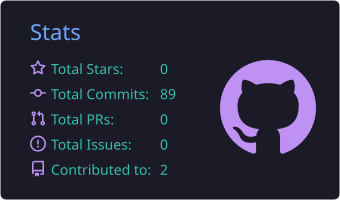
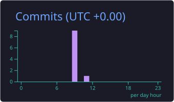
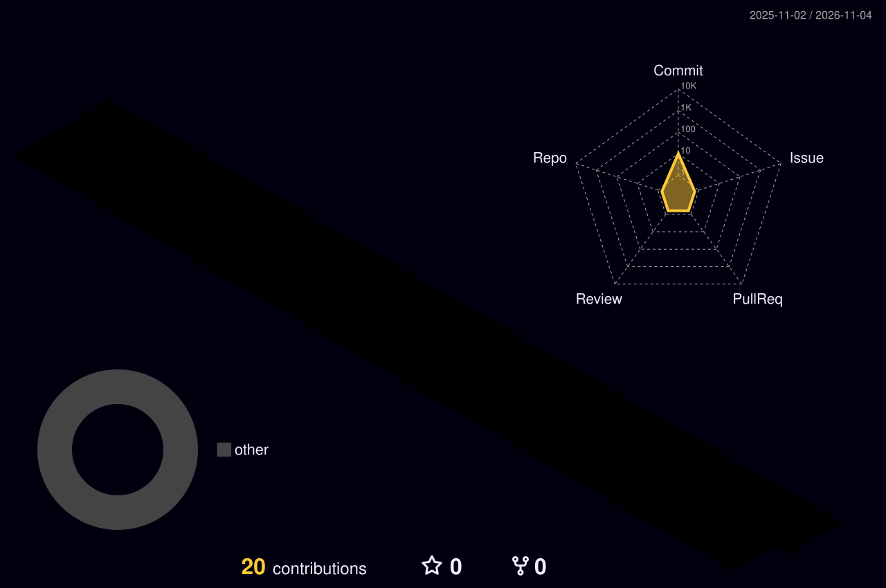

<!-- ════════════════════  HEADER  ════════════════════ -->
<p align="center">
  
</p>

<p align="center">
  <a href="https://github.com/AJEETCHAURASIYA">
    
  </a>
</p>

<p align="center">
  
  <a href="https://github.com/AJEETCHAURASIYA?tab=followers"></a>
  <a href="https://github.com/AJEETCHAURASIYA?tab=repositories"></a>
</p>

<p align="center">
  <a href="https://www.linkedin.com/in/ajeet-chaurasiya-3ba165251/"></a>
  <a href="mailto:ajeetsofra@gmail.com"></a>
  <a href="https://instagram.com/itsajeet_07/"></a>
  <a href="https://auth.geeksforgeeks.org/user/ajeets5ta0/"></a>
  <a href="https://sofraconsultancy.com"></a>
</p>

---

<!-- ════════════════════  ABOUT  ════════════════════ -->


##  About me

```python
class AjeetChaurasiya:
    role       = "Full Stack Developer & ML Engineer"
    building   = "Sofra Consultancy Services — IT services, web & software"
    learned    = ["Django Full Stack", "Laravel", "REST APIs", "SQL"]
    learning   = ["Machine Learning", "Deep Learning", "Cloud & DevOps"]
    ask_me     = "Full stack web development and machine learning"
    reach_me   = "ajeetsofra@gmail.com"
    fun_fact   = "I turn coffee ☕ and curiosity into shipped products"
```

- 🔭 Building websites, admin panels, billing/ERP tools and ML experiments
- 🌱 Currently diving deeper into **Machine Learning** and **data engineering**
- 👯 Happy to collaborate on **open source**, **web apps** and **AI projects**
- ⚡ All my projects live at **[github.com/AJEETCHAURASIYA](https://github.com/AJEETCHAURASIYA?tab=repositories)**

<br clear="right"/>

---

<!-- ════════════════════  TECH STACK  ════════════════════ -->
## 🛠️ Tech stack

<details open>
<summary><b>💻 Languages</b></summary><br/>
<p align="center"></p>
</details>

<details open>
<summary><b>🌐 Frameworks & web</b></summary><br/>
<p align="center"></p>
</details>

<details open>
<summary><b>🧠 Data & machine learning</b></summary><br/>
<p align="center">
  
  
  
  
</p>
</details>

<details open>
<summary><b>🗄️ Databases, cloud & big data</b></summary><br/>
<p align="center">
  
  
  
  
  
</p>
</details>

<details open>
<summary><b>🎨 Tools & design</b></summary><br/>
<p align="center"></p>
</details>

---

<!-- ════════════════════  3D MODEL  ════════════════════ -->
## 🧊 Interactive 3D model

> Drag to rotate, scroll to zoom — GitHub renders this `.stl` model live in your browser.

```stl
solid ajeet_knot
facet normal -0.45 -0.46 -0.77
outer loop
vertex 14.0 0.7 1.6
vertex 13.1 3.8 0.2
vertex 14.8 4.0 -0.9
endloop
endfacet
facet normal -0.59 -0.38 -0.71
outer loop
vertex 14.0 0.7 1.6
vertex 14.8 4.0 -0.9
vertex 15.6 0.2 0.5
endloop
endfacet
facet normal -0.97 -0.12 0.23
outer loop
vertex 15.6 0.2 0.5
vertex 14.8 4.0 -0.9
vertex 14.5 3.1 -2.6
endloop
endfacet
facet normal -0.94 -0.00 0.33
outer loop
vertex 15.6 0.2 0.5
vertex 14.5 3.1 -2.6
vertex 15.0 -0.5 -1.3
endloop
endfacet
facet normal -0.14 0.34 0.93
outer loop
vertex 15.0 -0.5 -1.3
vertex 14.5 3.1 -2.6
vertex 12.7 2.3 -2.6
endloop
endfacet
facet normal -0.00 0.43 0.90
outer loop
vertex 15.0 -0.5 -1.3
vertex 12.7 2.3 -2.6
vertex 13.0 -0.5 -1.3
endloop
endfacet
facet normal 0.89 0.28 0.36
outer loop
vertex 13.0 -0.5 -1.3
vertex 12.7 2.3 -2.6
vertex 11.8 2.8 -0.9
endloop
endfacet
facet normal 0.93 0.31 0.20
outer loop
vertex 13.0 -0.5 -1.3
vertex 11.8 2.8 -0.9
vertex 12.4 0.2 0.5
endloop
endfacet
facet normal 0.71 -0.20 -0.68
outer loop
vertex 12.4 0.2 0.5
vertex 11.8 2.8 -0.9
vertex 13.1 3.8 0.2
endloop
endfacet
facet normal 0.58 -0.19 -0.79
outer loop
vertex 12.4 0.2 0.5
vertex 13.1 3.8 0.2
vertex 14.0 0.7 1.6
endloop
endfacet
facet normal -0.27 -0.57 -0.78
outer loop
vertex 13.1 3.8 0.2
vertex 11.3 6.3 -1.0
vertex 12.7 7.1 -2.1
endloop
endfacet
facet normal -0.41 -0.55 -0.73
outer loop
vertex 13.1 3.8 0.2
vertex 12.7 7.1 -2.1
vertex 14.8 4.0 -0.9
endloop
endfacet
facet normal -0.85 -0.47 0.24
outer loop
vertex 14.8 4.0 -0.9
vertex 12.7 7.1 -2.1
vertex 12.7 6.2 -3.9
endloop
endfacet
facet normal -0.87 -0.36 0.34
outer loop
vertex 14.8 4.0 -0.9
vertex 12.7 6.2 -3.9
vertex 14.5 3.1 -2.6
endloop
endfacet
facet normal -0.23 0.24 0.94
outer loop
vertex 14.5 3.1 -2.6
vertex 12.7 6.2 -3.9
vertex 11.2 4.9 -3.9
endloop
endfacet
facet normal -0.15 0.36 0.92
outer loop
vertex 14.5 3.1 -2.6
vertex 11.2 4.9 -3.9
vertex 12.7 2.3 -2.6
endloop
endfacet
facet normal 0.74 0.58 0.35
outer loop
vertex 12.7 2.3 -2.6
vertex 11.2 4.9 -3.9
vertex 10.4 4.9 -2.1
endloop
endfacet
facet normal 0.75 0.62 0.21
outer loop
vertex 12.7 2.3 -2.6
vertex 10.4 4.9 -2.1
vertex 11.8 2.8 -0.9
endloop
endfacet
facet normal 0.71 0.09 -0.70
outer loop
vertex 11.8 2.8 -0.9
vertex 10.4 4.9 -2.1
vertex 11.3 6.3 -1.0
endloop
endfacet
facet normal 0.60 0.07 -0.80
outer loop
vertex 11.8 2.8 -0.9
vertex 11.3 6.3 -1.0
vertex 13.1 3.8 0.2
endloop
endfacet
facet normal -0.12 -0.60 -0.79
outer loop
vertex 11.3 6.3 -1.0
vertex 8.9 7.9 -1.8
vertex 9.8 9.2 -3.0
endloop
endfacet
facet normal -0.22 -0.62 -0.75
outer loop
vertex 11.3 6.3 -1.0
vertex 9.8 9.2 -3.0
vertex 12.7 7.1 -2.1
endloop
endfacet
facet normal -0.62 -0.74 0.26
outer loop
vertex 12.7 7.1 -2.1
vertex 9.8 9.2 -3.0
vertex 9.9 8.5 -4.8
endloop
endfacet
facet normal -0.66 -0.68 0.34
outer loop
vertex 12.7 7.1 -2.1
vertex 9.9 8.5 -4.8
vertex 12.7 6.2 -3.9
endloop
endfacet
facet normal -0.23 0.11 0.97
outer loop
vertex 12.7 6.2 -3.9
vertex 9.9 8.5 -4.8
vertex 9.0 6.7 -4.8
endloop
endfacet
facet normal -0.21 0.23 0.95
outer loop
vertex 12.7 6.2 -3.9
vertex 9.0 6.7 -4.8
vertex 11.2 4.9 -3.9
endloop
endfacet
facet normal 0.51 0.79 0.34
outer loop
vertex 11.2 4.9 -3.9
vertex 9.0 6.7 -4.8
vertex 8.4 6.3 -3.0
endloop
endfacet
facet normal 0.50 0.84 0.23
outer loop
vertex 11.2 4.9 -3.9
vertex 8.4 6.3 -3.0
vertex 10.4 4.9 -2.1
endloop
endfacet
facet normal 0.58 0.36 -0.73
outer loop
vertex 10.4 4.9 -2.1
vertex 8.4 6.3 -3.0
vertex 8.9 7.9 -1.8
endloop
endfacet
facet normal 0.49 0.32 -0.81
outer loop
vertex 10.4 4.9 -2.1
vertex 8.9 7.9 -1.8
vertex 11.3 6.3 -1.0
endloop
endfacet
facet normal -0.03 -0.59 -0.81
outer loop
vertex 8.9 7.9 -1.8
vertex 6.2 8.6 -2.2
vertex 6.6 10.2 -3.4
endloop
endfacet
facet normal -0.07 -0.62 -0.78
outer loop
vertex 8.9 7.9 -1.8
vertex 6.6 10.2 -3.4
vertex 9.8 9.2 -3.0
endloop
endfacet
facet normal -0.31 -0.90 0.29
outer loop
vertex 9.8 9.2 -3.0
vertex 6.6 10.2 -3.4
vertex 6.6 9.6 -5.3
endloop
endfacet
facet normal -0.34 -0.88 0.33
outer loop
vertex 9.8 9.2 -3.0
vertex 6.6 9.6 -5.3
vertex 9.9 8.5 -4.8
endloop
endfacet
facet normal -0.15 0.02 0.99
outer loop
vertex 9.9 8.5 -4.8
vertex 6.6 9.6 -5.3
vertex 6.4 7.6 -5.3
endloop
endfacet
facet normal -0.16 0.08 0.98
outer loop
vertex 9.9 8.5 -4.8
vertex 6.4 7.6 -5.3
vertex 9.0 6.7 -4.8
endloop
endfacet
facet normal 0.25 0.92 0.32
outer loop
vertex 9.0 6.7 -4.8
vertex 6.4 7.6 -5.3
vertex 6.1 7.0 -3.4
endloop
endfacet
facet normal 0.22 0.94 0.26
outer loop
vertex 9.0 6.7 -4.8
vertex 6.1 7.0 -3.4
vertex 8.4 6.3 -3.0
endloop
endfacet
facet normal 0.32 0.54 -0.78
outer loop
vertex 8.4 6.3 -3.0
vertex 6.1 7.0 -3.4
vertex 6.2 8.6 -2.2
endloop
endfacet
facet normal 0.28 0.51 -0.81
outer loop
vertex 8.4 6.3 -3.0
vertex 6.2 8.6 -2.2
vertex 8.9 7.9 -1.8
endloop
endfacet
facet normal 0.01 -0.59 -0.80
outer loop
vertex 6.2 8.6 -2.2
vertex 3.8 8.6 -2.2
vertex 3.5 10.1 -3.4
endloop
endfacet
facet normal 0.01 -0.59 -0.80
outer loop
vertex 6.2 8.6 -2.2
vertex 3.5 10.1 -3.4
vertex 6.6 10.2 -3.4
endloop
endfacet
facet normal 0.01 -0.95 0.32
outer loop
vertex 6.6 10.2 -3.4
vertex 3.5 10.1 -3.4
vertex 3.4 9.5 -5.3
endloop
endfacet
facet normal 0.01 -0.95 0.32
outer loop
vertex 6.6 10.2 -3.4
vertex 3.4 9.5 -5.3
vertex 6.6 9.6 -5.3
endloop
endfacet
facet normal 0.00 0.00 1.00
outer loop
vertex 6.6 9.6 -5.3
vertex 3.4 9.5 -5.3
vertex 3.7 7.5 -5.3
endloop
endfacet
facet normal 0.00 -0.00 1.00
outer loop
vertex 6.6 9.6 -5.3
vertex 3.7 7.5 -5.3
vertex 6.4 7.6 -5.3
endloop
endfacet
facet normal -0.01 0.96 0.30
outer loop
vertex 6.4 7.6 -5.3
vertex 3.7 7.5 -5.3
vertex 4.0 7.0 -3.4
endloop
endfacet
facet normal -0.01 0.96 0.30
outer loop
vertex 6.4 7.6 -5.3
vertex 4.0 7.0 -3.4
vertex 6.1 7.0 -3.4
endloop
endfacet
facet normal -0.01 0.59 -0.81
outer loop
vertex 6.1 7.0 -3.4
vertex 4.0 7.0 -3.4
vertex 3.8 8.6 -2.2
endloop
endfacet
facet normal -0.01 0.59 -0.81
outer loop
vertex 6.1 7.0 -3.4
vertex 3.8 8.6 -2.2
vertex 6.2 8.6 -2.2
endloop
endfacet
facet normal 0.00 -0.64 -0.77
outer loop
vertex 3.8 8.6 -2.2
vertex 1.9 8.1 -1.8
vertex 0.9 9.4 -3.0
endloop
endfacet
facet normal 0.02 -0.59 -0.81
outer loop
vertex 3.8 8.6 -2.2
vertex 0.9 9.4 -3.0
vertex 3.5 10.1 -3.4
endloop
endfacet
facet normal 0.31 -0.89 0.34
outer loop
vertex 3.5 10.1 -3.4
vertex 0.9 9.4 -3.0
vertex 0.6 8.6 -4.8
endloop
endfacet
facet normal 0.34 -0.90 0.29
outer loop
vertex 3.5 10.1 -3.4
vertex 0.6 8.6 -4.8
vertex 3.4 9.5 -5.3
endloop
endfacet
facet normal 0.17 0.07 0.98
outer loop
vertex 3.4 9.5 -5.3
vertex 0.6 8.6 -4.8
vertex 1.4 6.8 -4.8
endloop
endfacet
facet normal 0.21 0.03 0.98
outer loop
vertex 3.4 9.5 -5.3
vertex 1.4 6.8 -4.8
vertex 3.7 7.5 -5.3
endloop
endfacet
facet normal -0.23 0.93 0.28
outer loop
vertex 3.7 7.5 -5.3
vertex 1.4 6.8 -4.8
vertex 2.2 6.5 -3.0
endloop
endfacet
facet normal -0.18 0.93 0.31
outer loop
vertex 3.7 7.5 -5.3
vertex 2.2 6.5 -3.0
vertex 4.0 7.0 -3.4
endloop
endfacet
facet normal -0.34 0.49 -0.80
outer loop
vertex 4.0 7.0 -3.4
vertex 2.2 6.5 -3.0
vertex 1.9 8.1 -1.8
endloop
endfacet
facet normal -0.29 0.54 -0.79
outer loop
vertex 4.0 7.0 -3.4
vertex 1.9 8.1 -1.8
vertex 3.8 8.6 -2.2
endloop
endfacet
facet normal -0.02 -0.71 -0.71
outer loop
vertex 1.9 8.1 -1.8
vertex 0.3 7.4 -1.1
vertex -1.0 8.4 -2.1
endloop
endfacet
facet normal -0.01 -0.64 -0.77
outer loop
vertex 1.9 8.1 -1.8
vertex -1.0 8.4 -2.1
vertex 0.9 9.4 -3.0
endloop
endfacet
facet normal 0.54 -0.77 0.33
outer loop
vertex 0.9 9.4 -3.0
vertex -1.0 8.4 -2.1
vertex -1.5 7.4 -3.8
endloop
endfacet
facet normal 0.57 -0.78 0.25
outer loop
vertex 0.9 9.4 -3.0
vertex -1.5 7.4 -3.8
vertex 0.6 8.6 -4.8
endloop
endfacet
facet normal 0.32 0.20 0.92
outer loop
vertex 0.6 8.6 -4.8
vertex -1.5 7.4 -3.8
vertex -0.4 5.7 -3.8
endloop
endfacet
facet normal 0.40 0.17 0.90
outer loop
vertex 0.6 8.6 -4.8
vertex -0.4 5.7 -3.8
vertex 1.4 6.8 -4.8
endloop
endfacet
facet normal -0.38 0.89 0.27
outer loop
vertex 1.4 6.8 -4.8
vertex -0.4 5.7 -3.8
vertex 0.7 5.7 -2.1
endloop
endfacet
facet normal -0.29 0.91 0.30
outer loop
vertex 1.4 6.8 -4.8
vertex 0.7 5.7 -2.1
vertex 2.2 6.5 -3.0
endloop
endfacet
facet normal -0.59 0.32 -0.74
outer loop
vertex 2.2 6.5 -3.0
vertex 0.7 5.7 -2.1
vertex 0.3 7.4 -1.1
endloop
endfacet
facet normal -0.54 0.41 -0.74
outer loop
vertex 2.2 6.5 -3.0
vertex 0.3 7.4 -1.1
vertex 1.9 8.1 -1.8
endloop
endfacet
facet normal -0.06 -0.76 -0.65
outer loop
vertex 0.3 7.4 -1.1
vertex -0.9 6.6 -0.1
vertex -2.4 7.5 -1.0
endloop
endfacet
facet normal -0.06 -0.74 -0.67
outer loop
vertex 0.3 7.4 -1.1
vertex -2.4 7.5 -1.0
vertex -1.0 8.4 -2.1
endloop
endfacet
facet normal 0.68 -0.69 0.26
outer loop
vertex -1.0 8.4 -2.1
vertex -2.4 7.5 -1.0
vertex -3.1 6.3 -2.4
endloop
endfacet
facet normal 0.69 -0.69 0.23
outer loop
vertex -1.0 8.4 -2.1
vertex -3.1 6.3 -2.4
vertex -1.5 7.4 -3.8
endloop
endfacet
facet normal 0.47 0.33 0.82
outer loop
vertex -1.5 7.4 -3.8
vertex -3.1 6.3 -2.4
vertex -2.0 4.6 -2.4
endloop
endfacet
facet normal 0.50 0.32 0.81
outer loop
vertex -1.5 7.4 -3.8
vertex -2.0 4.6 -2.4
vertex -0.4 5.7 -3.8
endloop
endfacet
facet normal -0.40 0.88 0.25
outer loop
vertex -0.4 5.7 -3.8
vertex -2.0 4.6 -2.4
vertex -0.6 4.8 -1.0
endloop
endfacet
facet normal -0.37 0.89 0.26
outer loop
vertex -0.4 5.7 -3.8
vertex -0.6 4.8 -1.0
vertex 0.7 5.7 -2.1
endloop
endfacet
facet normal -0.73 0.21 -0.65
outer loop
vertex 0.7 5.7 -2.1
vertex -0.6 4.8 -1.0
vertex -0.9 6.6 -0.1
endloop
endfacet
facet normal -0.71 0.24 -0.66
outer loop
vertex 0.7 5.7 -2.1
vertex -0.9 6.6 -0.1
vertex 0.3 7.4 -1.1
endloop
endfacet
facet normal -0.16 -0.77 -0.62
outer loop
vertex -0.9 6.6 -0.1
vertex -2.0 5.8 1.2
vertex -3.5 6.8 0.4
endloop
endfacet
facet normal -0.15 -0.82 -0.56
outer loop
vertex -0.9 6.6 -0.1
vertex -3.5 6.8 0.4
vertex -2.4 7.5 -1.0
endloop
endfacet
facet normal 0.70 -0.69 0.18
outer loop
vertex -2.4 7.5 -1.0
vertex -3.5 6.8 0.4
vertex -4.3 5.6 -1.0
endloop
endfacet
facet normal 0.69 -0.68 0.26
outer loop
vertex -2.4 7.5 -1.0
vertex -4.3 5.6 -1.0
vertex -3.1 6.3 -2.4
endloop
endfacet
facet normal 0.61 0.35 0.71
outer loop
vertex -3.1 6.3 -2.4
vertex -4.3 5.6 -1.0
vertex -3.3 3.8 -1.0
endloop
endfacet
facet normal 0.55 0.38 0.74
outer loop
vertex -3.1 6.3 -2.4
vertex -3.3 3.8 -1.0
vertex -2.0 4.6 -2.4
endloop
endfacet
facet normal -0.30 0.93 0.23
outer loop
vertex -2.0 4.6 -2.4
vertex -3.3 3.8 -1.0
vertex -1.9 4.0 0.4
endloop
endfacet
facet normal -0.37 0.90 0.23
outer loop
vertex -2.0 4.6 -2.4
vertex -1.9 4.0 0.4
vertex -0.6 4.8 -1.0
endloop
endfacet
facet normal -0.77 0.23 -0.59
outer loop
vertex -0.6 4.8 -1.0
vertex -1.9 4.0 0.4
vertex -2.0 5.8 1.2
endloop
endfacet
facet normal -0.80 0.16 -0.58
outer loop
vertex -0.6 4.8 -1.0
vertex -2.0 5.8 1.2
vertex -0.9 6.6 -0.1
endloop
endfacet
facet normal -0.23 -0.76 -0.61
outer loop
vertex -2.0 5.8 1.2
vertex -3.3 5.0 2.7
vertex -4.7 6.1 1.8
endloop
endfacet
facet normal -0.22 -0.81 -0.55
outer loop
vertex -2.0 5.8 1.2
vertex -4.7 6.1 1.8
vertex -3.5 6.8 0.4
endloop
endfacet
facet normal 0.63 -0.75 0.19
outer loop
vertex -3.5 6.8 0.4
vertex -4.7 6.1 1.8
vertex -5.5 5.1 0.3
endloop
endfacet
facet normal 0.62 -0.74 0.27
outer loop
vertex -3.5 6.8 0.4
vertex -5.5 5.1 0.3
vertex -4.3 5.6 -1.0
endloop
endfacet
facet normal 0.64 0.30 0.70
outer loop
vertex -4.3 5.6 -1.0
vertex -5.5 5.1 0.3
vertex -4.7 3.3 0.3
endloop
endfacet
facet normal 0.58 0.33 0.74
outer loop
vertex -4.3 5.6 -1.0
vertex -4.7 3.3 0.3
vertex -3.3 3.8 -1.0
endloop
endfacet
facet normal -0.21 0.95 0.22
outer loop
vertex -3.3 3.8 -1.0
vertex -4.7 3.3 0.3
vertex -3.3 3.2 1.8
endloop
endfacet
facet normal -0.29 0.93 0.22
outer loop
vertex -3.3 3.8 -1.0
vertex -3.3 3.2 1.8
vertex -1.9 4.0 0.4
endloop
endfacet
facet normal -0.75 0.30 -0.59
outer loop
vertex -1.9 4.0 0.4
vertex -3.3 3.2 1.8
vertex -3.3 5.0 2.7
endloop
endfacet
facet normal -0.78 0.23 -0.58
outer loop
vertex -1.9 4.0 0.4
vertex -3.3 5.0 2.7
vertex -2.0 5.8 1.2
endloop
endfacet
facet normal -0.17 -0.75 -0.64
outer loop
vertex -3.3 5.0 2.7
vertex -5.0 4.2 4.0
vertex -6.3 5.4 3.0
endloop
endfacet
facet normal -0.17 -0.72 -0.67
outer loop
vertex -3.3 5.0 2.7
vertex -6.3 5.4 3.0
vertex -4.7 6.1 1.8
endloop
endfacet
facet normal 0.57 -0.77 0.27
outer loop
vertex -4.7 6.1 1.8
vertex -6.3 5.4 3.0
vertex -6.9 4.4 1.4
endloop
endfacet
facet normal 0.58 -0.78 0.24
outer loop
vertex -4.7 6.1 1.8
vertex -6.9 4.4 1.4
vertex -5.5 5.1 0.3
endloop
endfacet
facet normal 0.51 0.27 0.82
outer loop
vertex -5.5 5.1 0.3
vertex -6.9 4.4 1.4
vertex -5.9 2.6 1.4
endloop
endfacet
facet normal 0.54 0.25 0.80
outer loop
vertex -5.5 5.1 0.3
vertex -5.9 2.6 1.4
vertex -4.7 3.3 0.3
endloop
endfacet
facet normal -0.27 0.93 0.25
outer loop
vertex -4.7 3.3 0.3
vertex -5.9 2.6 1.4
vertex -4.8 2.5 3.0
endloop
endfacet
facet normal -0.24 0.94 0.25
outer loop
vertex -4.7 3.3 0.3
vertex -4.8 2.5 3.0
vertex -3.3 3.2 1.8
endloop
endfacet
facet normal -0.69 0.30 -0.66
outer loop
vertex -3.3 3.2 1.8
vertex -4.8 2.5 3.0
vertex -5.0 4.2 4.0
endloop
endfacet
facet normal -0.67 0.33 -0.66
outer loop
vertex -3.3 3.2 1.8
vertex -5.0 4.2 4.0
vertex -3.3 5.0 2.7
endloop
endfacet
facet normal 0.03 -0.70 -0.71
outer loop
vertex -5.0 4.2 4.0
vertex -7.1 3.0 5.1
vertex -8.4 4.1 4.0
endloop
endfacet
facet normal 0.03 -0.64 -0.77
outer loop
vertex -5.0 4.2 4.0
vertex -8.4 4.1 4.0
vertex -6.3 5.4 3.0
endloop
endfacet
facet normal 0.59 -0.74 0.31
outer loop
vertex -6.3 5.4 3.0
vertex -8.4 4.1 4.0
vertex -8.4 3.3 2.2
endloop
endfacet
facet normal 0.63 -0.74 0.23
outer loop
vertex -6.3 5.4 3.0
vertex -8.4 3.3 2.2
vertex -6.9 4.4 1.4
endloop
endfacet
facet normal 0.30 0.22 0.93
outer loop
vertex -6.9 4.4 1.4
vertex -8.4 3.3 2.2
vertex -7.2 1.7 2.2
endloop
endfacet
facet normal 0.39 0.20 0.90
outer loop
vertex -6.9 4.4 1.4
vertex -7.2 1.7 2.2
vertex -5.9 2.6 1.4
endloop
endfacet
facet normal -0.44 0.86 0.27
outer loop
vertex -5.9 2.6 1.4
vertex -7.2 1.7 2.2
vertex -6.4 1.5 4.0
endloop
endfacet
facet normal -0.35 0.89 0.30
outer loop
vertex -5.9 2.6 1.4
vertex -6.4 1.5 4.0
vertex -4.8 2.5 3.0
endloop
endfacet
facet normal -0.60 0.28 -0.75
outer loop
vertex -4.8 2.5 3.0
vertex -6.4 1.5 4.0
vertex -7.1 3.0 5.1
endloop
endfacet
facet normal -0.57 0.36 -0.74
outer loop
vertex -4.8 2.5 3.0
vertex -7.1 3.0 5.1
vertex -5.0 4.2 4.0
endloop
endfacet
facet normal 0.29 -0.56 -0.78
outer loop
vertex -7.1 3.0 5.1
vertex -9.1 1.2 5.6
vertex -10.5 2.1 4.5
endloop
endfacet
facet normal 0.29 -0.51 -0.81
outer loop
vertex -7.1 3.0 5.1
vertex -10.5 2.1 4.5
vertex -8.4 4.1 4.0
endloop
endfacet
facet normal 0.69 -0.65 0.32
outer loop
vertex -8.4 4.1 4.0
vertex -10.5 2.1 4.5
vertex -10.1 1.6 2.6
endloop
endfacet
facet normal 0.72 -0.64 0.26
outer loop
vertex -8.4 4.1 4.0
vertex -10.1 1.6 2.6
vertex -8.4 3.3 2.2
endloop
endfacet
facet normal 0.11 0.14 0.98
outer loop
vertex -8.4 3.3 2.2
vertex -10.1 1.6 2.6
vertex -8.5 0.4 2.6
endloop
endfacet
facet normal 0.18 0.13 0.98
outer loop
vertex -8.4 3.3 2.2
vertex -8.5 0.4 2.6
vertex -7.2 1.7 2.2
endloop
endfacet
facet normal -0.64 0.71 0.29
outer loop
vertex -7.2 1.7 2.2
vertex -8.5 0.4 2.6
vertex -8.0 0.1 4.5
endloop
endfacet
facet normal -0.59 0.74 0.33
outer loop
vertex -7.2 1.7 2.2
vertex -8.0 0.1 4.5
vertex -6.4 1.5 4.0
endloop
endfacet
facet normal -0.53 0.28 -0.80
outer loop
vertex -6.4 1.5 4.0
vertex -8.0 0.1 4.5
vertex -9.1 1.2 5.6
endloop
endfacet
facet normal -0.52 0.34 -0.78
outer loop
vertex -6.4 1.5 4.0
vertex -9.1 1.2 5.6
vertex -7.1 3.0 5.1
endloop
endfacet
facet normal 0.50 -0.30 -0.81
outer loop
vertex -9.1 1.2 5.6
vertex -10.7 -1.4 5.6
vertex -12.1 -0.7 4.5
endloop
endfacet
facet normal 0.50 -0.30 -0.81
outer loop
vertex -9.1 1.2 5.6
vertex -12.1 -0.7 4.5
vertex -10.5 2.1 4.5
endloop
endfacet
facet normal 0.82 -0.49 0.30
outer loop
vertex -10.5 2.1 4.5
vertex -12.1 -0.7 4.5
vertex -11.5 -0.8 2.6
endloop
endfacet
facet normal 0.82 -0.49 0.30
outer loop
vertex -10.5 2.1 4.5
vertex -11.5 -0.8 2.6
vertex -10.1 1.6 2.6
endloop
endfacet
facet normal -0.00 -0.00 1.00
outer loop
vertex -10.1 1.6 2.6
vertex -11.5 -0.8 2.6
vertex -9.7 -1.5 2.6
endloop
endfacet
facet normal -0.00 -0.00 1.00
outer loop
vertex -10.1 1.6 2.6
vertex -9.7 -1.5 2.6
vertex -8.5 0.4 2.6
endloop
endfacet
facet normal -0.82 0.48 0.32
outer loop
vertex -8.5 0.4 2.6
vertex -9.7 -1.5 2.6
vertex -9.1 -1.9 4.5
endloop
endfacet
facet normal -0.81 0.48 0.32
outer loop
vertex -8.5 0.4 2.6
vertex -9.1 -1.9 4.5
vertex -8.0 0.1 4.5
endloop
endfacet
facet normal -0.51 0.30 -0.80
outer loop
vertex -8.0 0.1 4.5
vertex -9.1 -1.9 4.5
vertex -10.7 -1.4 5.6
endloop
endfacet
facet normal -0.51 0.30 -0.80
outer loop
vertex -8.0 0.1 4.5
vertex -10.7 -1.4 5.6
vertex -9.1 1.2 5.6
endloop
endfacet
facet normal 0.58 0.02 -0.81
outer loop
vertex -10.7 -1.4 5.6
vertex -11.3 -4.5 5.1
vertex -12.9 -4.1 4.0
endloop
endfacet
facet normal 0.62 -0.03 -0.79
outer loop
vertex -10.7 -1.4 5.6
vertex -12.9 -4.1 4.0
vertex -12.1 -0.7 4.5
endloop
endfacet
facet normal 0.93 -0.24 0.27
outer loop
vertex -12.1 -0.7 4.5
vertex -12.9 -4.1 4.0
vertex -12.3 -3.7 2.1
endloop
endfacet
facet normal 0.91 -0.28 0.32
outer loop
vertex -12.1 -0.7 4.5
vertex -12.3 -3.7 2.1
vertex -11.5 -0.8 2.6
endloop
endfacet
facet normal -0.01 -0.15 0.99
outer loop
vertex -11.5 -0.8 2.6
vertex -12.3 -3.7 2.1
vertex -10.3 -3.9 2.1
endloop
endfacet
facet normal -0.07 -0.17 0.98
outer loop
vertex -11.5 -0.8 2.6
vertex -10.3 -3.9 2.1
vertex -9.7 -1.5 2.6
endloop
endfacet
facet normal -0.92 0.18 0.34
outer loop
vertex -9.7 -1.5 2.6
vertex -10.3 -3.9 2.1
vertex -9.7 -4.3 4.0
endloop
endfacet
facet normal -0.95 0.15 0.29
outer loop
vertex -9.7 -1.5 2.6
vertex -9.7 -4.3 4.0
vertex -9.1 -1.9 4.5
endloop
endfacet
facet normal -0.57 0.28 -0.77
outer loop
vertex -9.1 -1.9 4.5
vertex -9.7 -4.3 4.0
vertex -11.3 -4.5 5.1
endloop
endfacet
facet normal -0.54 0.24 -0.81
outer loop
vertex -9.1 -1.9 4.5
vertex -11.3 -4.5 5.1
vertex -10.7 -1.4 5.6
endloop
endfacet
facet normal 0.51 0.32 -0.80
outer loop
vertex -11.3 -4.5 5.1
vertex -10.8 -7.7 4.2
vertex -12.4 -7.8 3.1
endloop
endfacet
facet normal 0.60 0.26 -0.76
outer loop
vertex -11.3 -4.5 5.1
vertex -12.4 -7.8 3.1
vertex -12.9 -4.1 4.0
endloop
endfacet
facet normal 0.97 0.07 0.25
outer loop
vertex -12.9 -4.1 4.0
vertex -12.4 -7.8 3.1
vertex -12.0 -7.0 1.3
endloop
endfacet
facet normal 0.95 -0.01 0.33
outer loop
vertex -12.9 -4.1 4.0
vertex -12.0 -7.0 1.3
vertex -12.3 -3.7 2.1
endloop
endfacet
facet normal 0.07 -0.24 0.97
outer loop
vertex -12.3 -3.7 2.1
vertex -12.0 -7.0 1.3
vertex -10.1 -6.5 1.3
endloop
endfacet
facet normal -0.02 -0.31 0.95
outer loop
vertex -12.3 -3.7 2.1
vertex -10.1 -6.5 1.3
vertex -10.3 -3.9 2.1
endloop
endfacet
facet normal -0.92 -0.18 0.35
outer loop
vertex -10.3 -3.9 2.1
vertex -10.1 -6.5 1.3
vertex -9.3 -6.9 3.1
endloop
endfacet
facet normal -0.94 -0.22 0.25
outer loop
vertex -10.3 -3.9 2.1
vertex -9.3 -6.9 3.1
vertex -9.7 -4.3 4.0
endloop
endfacet
facet normal -0.66 0.17 -0.73
outer loop
vertex -9.7 -4.3 4.0
vertex -9.3 -6.9 3.1
vertex -10.8 -7.7 4.2
endloop
endfacet
facet normal -0.58 0.14 -0.80
outer loop
vertex -9.7 -4.3 4.0
vertex -10.8 -7.7 4.2
vertex -11.3 -4.5 5.1
endloop
endfacet
facet normal 0.32 0.54 -0.78
outer loop
vertex -10.8 -7.7 4.2
vertex -9.0 -10.5 2.9
vertex -10.6 -11.2 1.9
endloop
endfacet
facet normal 0.46 0.51 -0.73
outer loop
vertex -10.8 -7.7 4.2
vertex -10.6 -11.2 1.9
vertex -12.4 -7.8 3.1
endloop
endfacet
facet normal 0.89 0.40 0.23
outer loop
vertex -12.4 -7.8 3.1
vertex -10.6 -11.2 1.9
vertex -10.5 -10.2 0.1
endloop
endfacet
facet normal 0.90 0.29 0.33
outer loop
vertex -12.4 -7.8 3.1
vertex -10.5 -10.2 0.1
vertex -12.0 -7.0 1.3
endloop
endfacet
facet normal 0.20 -0.26 0.94
outer loop
vertex -12.0 -7.0 1.3
vertex -10.5 -10.2 0.1
vertex -9.0 -9.0 0.1
endloop
endfacet
facet normal 0.12 -0.38 0.92
outer loop
vertex -12.0 -7.0 1.3
vertex -9.0 -9.0 0.1
vertex -10.1 -6.5 1.3
endloop
endfacet
facet normal -0.78 -0.51 0.36
outer loop
vertex -10.1 -6.5 1.3
vertex -9.0 -9.0 0.1
vertex -8.1 -9.2 1.9
endloop
endfacet
facet normal -0.80 -0.56 0.22
outer loop
vertex -10.1 -6.5 1.3
vertex -8.1 -9.2 1.9
vertex -9.3 -6.9 3.1
endloop
endfacet
facet normal -0.72 -0.03 -0.69
outer loop
vertex -9.3 -6.9 3.1
vertex -8.1 -9.2 1.9
vertex -9.0 -10.5 2.9
endloop
endfacet
facet normal -0.61 -0.02 -0.80
outer loop
vertex -9.3 -6.9 3.1
vertex -9.0 -10.5 2.9
vertex -10.8 -7.7 4.2
endloop
endfacet
facet normal 0.07 0.64 -0.77
outer loop
vertex -9.0 -10.5 2.9
vertex -6.4 -12.5 1.6
vertex -7.6 -13.6 0.5
endloop
endfacet
facet normal 0.22 0.66 -0.71
outer loop
vertex -9.0 -10.5 2.9
vertex -7.6 -13.6 0.5
vertex -10.6 -11.2 1.9
endloop
endfacet
facet normal 0.68 0.69 0.23
outer loop
vertex -10.6 -11.2 1.9
vertex -7.6 -13.6 0.5
vertex -8.0 -12.7 -1.3
endloop
endfacet
facet normal 0.74 0.58 0.33
outer loop
vertex -10.6 -11.2 1.9
vertex -8.0 -12.7 -1.3
vertex -10.5 -10.2 0.1
endloop
endfacet
facet normal 0.31 -0.18 0.93
outer loop
vertex -10.5 -10.2 0.1
vertex -8.0 -12.7 -1.3
vertex -7.0 -11.0 -1.3
endloop
endfacet
facet normal 0.27 -0.34 0.90
outer loop
vertex -10.5 -10.2 0.1
vertex -7.0 -11.0 -1.3
vertex -9.0 -9.0 0.1
endloop
endfacet
facet normal -0.53 -0.77 0.36
outer loop
vertex -9.0 -9.0 0.1
vertex -7.0 -11.0 -1.3
vertex -6.0 -10.8 0.5
endloop
endfacet
facet normal -0.54 -0.82 0.20
outer loop
vertex -9.0 -9.0 0.1
vertex -6.0 -10.8 0.5
vertex -8.1 -9.2 1.9
endloop
endfacet
facet normal -0.68 -0.28 -0.68
outer loop
vertex -8.1 -9.2 1.9
vertex -6.0 -10.8 0.5
vertex -6.4 -12.5 1.6
endloop
endfacet
facet normal -0.57 -0.21 -0.79
outer loop
vertex -8.1 -9.2 1.9
vertex -6.4 -12.5 1.6
vertex -9.0 -10.5 2.9
endloop
endfacet
facet normal -0.17 0.62 -0.77
outer loop
vertex -6.4 -12.5 1.6
vertex -3.3 -13.3 0.2
vertex -4.0 -14.8 -0.9
endloop
endfacet
facet normal -0.04 0.70 -0.71
outer loop
vertex -6.4 -12.5 1.6
vertex -4.0 -14.8 -0.9
vertex -7.6 -13.6 0.5
endloop
endfacet
facet normal 0.38 0.90 0.23
outer loop
vertex -7.6 -13.6 0.5
vertex -4.0 -14.8 -0.9
vertex -4.6 -14.1 -2.6
endloop
endfacet
facet normal 0.47 0.82 0.33
outer loop
vertex -7.6 -13.6 0.5
vertex -4.6 -14.1 -2.6
vertex -8.0 -12.7 -1.3
endloop
endfacet
facet normal 0.36 -0.05 0.93
outer loop
vertex -8.0 -12.7 -1.3
vertex -4.6 -14.1 -2.6
vertex -4.3 -12.1 -2.6
endloop
endfacet
facet normal 0.38 -0.22 0.90
outer loop
vertex -8.0 -12.7 -1.3
vertex -4.3 -12.1 -2.6
vertex -7.0 -11.0 -1.3
endloop
endfacet
facet normal -0.20 -0.91 0.36
outer loop
vertex -7.0 -11.0 -1.3
vertex -4.3 -12.1 -2.6
vertex -3.5 -11.6 -0.9
endloop
endfacet
facet normal -0.19 -0.96 0.20
outer loop
vertex -7.0 -11.0 -1.3
vertex -3.5 -11.6 -0.9
vertex -6.0 -10.8 0.5
endloop
endfacet
facet normal -0.53 -0.51 -0.68
outer loop
vertex -6.0 -10.8 0.5
vertex -3.5 -11.6 -0.9
vertex -3.3 -13.3 0.2
endloop
endfacet
facet normal -0.45 -0.41 -0.79
outer loop
vertex -6.0 -10.8 0.5
vertex -3.3 -13.3 0.2
vertex -6.4 -12.5 1.6
endloop
endfacet
facet normal -0.35 0.52 -0.78
outer loop
vertex -3.3 -13.3 0.2
vertex -0.2 -12.9 -1.0
vertex -0.2 -14.6 -2.1
endloop
endfacet
facet normal -0.27 0.63 -0.73
outer loop
vertex -3.3 -13.3 0.2
vertex -0.2 -14.6 -2.1
vertex -4.0 -14.8 -0.9
endloop
endfacet
facet normal 0.02 0.97 0.24
outer loop
vertex -4.0 -14.8 -0.9
vertex -0.2 -14.6 -2.1
vertex -1.0 -14.1 -3.9
endloop
endfacet
facet normal 0.12 0.93 0.34
outer loop
vertex -4.0 -14.8 -0.9
vertex -1.0 -14.1 -3.9
vertex -4.6 -14.1 -2.6
endloop
endfacet
facet normal 0.32 0.08 0.94
outer loop
vertex -4.6 -14.1 -2.6
vertex -1.0 -14.1 -3.9
vertex -1.4 -12.2 -3.9
endloop
endfacet
facet normal 0.39 -0.06 0.92
outer loop
vertex -4.6 -14.1 -2.6
vertex -1.4 -12.2 -3.9
vertex -4.3 -12.1 -2.6
endloop
endfacet
facet normal 0.13 -0.93 0.35
outer loop
vertex -4.3 -12.1 -2.6
vertex -1.4 -12.2 -3.9
vertex -1.0 -11.4 -2.1
endloop
endfacet
facet normal 0.16 -0.96 0.21
outer loop
vertex -4.3 -12.1 -2.6
vertex -1.0 -11.4 -2.1
vertex -3.5 -11.6 -0.9
endloop
endfacet
facet normal -0.28 -0.66 -0.70
outer loop
vertex -3.5 -11.6 -0.9
vertex -1.0 -11.4 -2.1
vertex -0.2 -12.9 -1.0
endloop
endfacet
facet normal -0.24 -0.55 -0.80
outer loop
vertex -3.5 -11.6 -0.9
vertex -0.2 -12.9 -1.0
vertex -3.3 -13.3 0.2
endloop
endfacet
facet normal -0.46 0.40 -0.79
outer loop
vertex -0.2 -12.9 -1.0
vertex 2.4 -11.6 -1.8
vertex 3.1 -13.1 -3.0
endloop
endfacet
facet normal -0.43 0.50 -0.75
outer loop
vertex -0.2 -12.9 -1.0
vertex 3.1 -13.1 -3.0
vertex -0.2 -14.6 -2.1
endloop
endfacet
facet normal -0.33 0.90 0.26
outer loop
vertex -0.2 -14.6 -2.1
vertex 3.1 -13.1 -3.0
vertex 2.4 -12.8 -4.8
endloop
endfacet
facet normal -0.26 0.91 0.34
outer loop
vertex -0.2 -14.6 -2.1
vertex 2.4 -12.8 -4.8
vertex -1.0 -14.1 -3.9
endloop
endfacet
facet normal 0.21 0.14 0.97
outer loop
vertex -1.0 -14.1 -3.9
vertex 2.4 -12.8 -4.8
vertex 1.3 -11.2 -4.8
endloop
endfacet
facet normal 0.30 0.07 0.95
outer loop
vertex -1.0 -14.1 -3.9
vertex 1.3 -11.2 -4.8
vertex -1.4 -12.2 -3.9
endloop
endfacet
facet normal 0.43 -0.84 0.34
outer loop
vertex -1.4 -12.2 -3.9
vertex 1.3 -11.2 -4.8
vertex 1.3 -10.4 -3.0
endloop
endfacet
facet normal 0.48 -0.85 0.23
outer loop
vertex -1.4 -12.2 -3.9
vertex 1.3 -10.4 -3.0
vertex -1.0 -11.4 -2.1
endloop
endfacet
facet normal 0.02 -0.68 -0.73
outer loop
vertex -1.0 -11.4 -2.1
vertex 1.3 -10.4 -3.0
vertex 2.4 -11.6 -1.8
endloop
endfacet
facet normal 0.03 -0.59 -0.81
outer loop
vertex -1.0 -11.4 -2.1
vertex 2.4 -11.6 -1.8
vertex -0.2 -12.9 -1.0
endloop
endfacet
facet normal -0.50 0.32 -0.81
outer loop
vertex 2.4 -11.6 -1.8
vertex 4.3 -9.7 -2.2
vertex 5.5 -10.8 -3.4
endloop
endfacet
facet normal -0.50 0.37 -0.78
outer loop
vertex 2.4 -11.6 -1.8
vertex 5.5 -10.8 -3.4
vertex 3.1 -13.1 -3.0
endloop
endfacet
facet normal -0.63 0.72 0.29
outer loop
vertex 3.1 -13.1 -3.0
vertex 5.5 -10.8 -3.4
vertex 5.0 -10.5 -5.3
endloop
endfacet
facet normal -0.59 0.74 0.33
outer loop
vertex 3.1 -13.1 -3.0
vertex 5.0 -10.5 -5.3
vertex 2.4 -12.8 -4.8
endloop
endfacet
facet normal 0.09 0.12 0.99
outer loop
vertex 2.4 -12.8 -4.8
vertex 5.0 -10.5 -5.3
vertex 3.4 -9.3 -5.3
endloop
endfacet
facet normal 0.15 0.10 0.98
outer loop
vertex 2.4 -12.8 -4.8
vertex 3.4 -9.3 -5.3
vertex 1.3 -11.2 -4.8
endloop
endfacet
facet normal 0.67 -0.67 0.32
outer loop
vertex 1.3 -11.2 -4.8
vertex 3.4 -9.3 -5.3
vertex 3.0 -8.8 -3.4
endloop
endfacet
facet normal 0.70 -0.66 0.26
outer loop
vertex 1.3 -11.2 -4.8
vertex 3.0 -8.8 -3.4
vertex 1.3 -10.4 -3.0
endloop
endfacet
facet normal 0.31 -0.55 -0.78
outer loop
vertex 1.3 -10.4 -3.0
vertex 3.0 -8.8 -3.4
vertex 4.3 -9.7 -2.2
endloop
endfacet
facet normal 0.30 -0.49 -0.81
outer loop
vertex 1.3 -10.4 -3.0
vertex 4.3 -9.7 -2.2
vertex 2.4 -11.6 -1.8
endloop
endfacet
facet normal -0.52 0.29 -0.80
outer loop
vertex 4.3 -9.7 -2.2
vertex 5.5 -7.6 -2.2
vertex 7.0 -8.1 -3.4
endloop
endfacet
facet normal -0.52 0.29 -0.80
outer loop
vertex 4.3 -9.7 -2.2
vertex 7.0 -8.1 -3.4
vertex 5.5 -10.8 -3.4
endloop
endfacet
facet normal -0.83 0.46 0.32
outer loop
vertex 5.5 -10.8 -3.4
vertex 7.0 -8.1 -3.4
vertex 6.5 -7.7 -5.3
endloop
endfacet
facet normal -0.83 0.46 0.32
outer loop
vertex 5.5 -10.8 -3.4
vertex 6.5 -7.7 -5.3
vertex 5.0 -10.5 -5.3
endloop
endfacet
facet normal -0.00 -0.00 1.00
outer loop
vertex 5.0 -10.5 -5.3
vertex 6.5 -7.7 -5.3
vertex 4.7 -7.0 -5.3
endloop
endfacet
facet normal -0.00 -0.00 1.00
outer loop
vertex 5.0 -10.5 -5.3
vertex 4.7 -7.0 -5.3
vertex 3.4 -9.3 -5.3
endloop
endfacet
facet normal 0.83 -0.47 0.30
outer loop
vertex 3.4 -9.3 -5.3
vertex 4.7 -7.0 -5.3
vertex 4.0 -6.9 -3.4
endloop
endfacet
facet normal 0.83 -0.47 0.30
outer loop
vertex 3.4 -9.3 -5.3
vertex 4.0 -6.9 -3.4
vertex 3.0 -8.8 -3.4
endloop
endfacet
facet normal 0.51 -0.29 -0.81
outer loop
vertex 3.0 -8.8 -3.4
vertex 4.0 -6.9 -3.4
vertex 5.5 -7.6 -2.2
endloop
endfacet
facet normal 0.51 -0.29 -0.81
outer loop
vertex 3.0 -8.8 -3.4
vertex 5.5 -7.6 -2.2
vertex 4.3 -9.7 -2.2
endloop
endfacet
facet normal -0.55 0.32 -0.77
outer loop
vertex 5.5 -7.6 -2.2
vertex 6.1 -5.7 -1.8
vertex 7.7 -5.5 -3.0
endloop
endfacet
facet normal -0.52 0.28 -0.81
outer loop
vertex 5.5 -7.6 -2.2
vertex 7.7 -5.5 -3.0
vertex 7.0 -8.1 -3.4
endloop
endfacet
facet normal -0.92 0.18 0.34
outer loop
vertex 7.0 -8.1 -3.4
vertex 7.7 -5.5 -3.0
vertex 7.2 -4.9 -4.8
endloop
endfacet
facet normal -0.94 0.16 0.29
outer loop
vertex 7.0 -8.1 -3.4
vertex 7.2 -4.9 -4.8
vertex 6.5 -7.7 -5.3
endloop
endfacet
facet normal -0.02 -0.18 0.98
outer loop
vertex 6.5 -7.7 -5.3
vertex 7.2 -4.9 -4.8
vertex 5.2 -4.6 -4.8
endloop
endfacet
facet normal -0.08 -0.20 0.98
outer loop
vertex 6.5 -7.7 -5.3
vertex 5.2 -4.6 -4.8
vertex 4.7 -7.0 -5.3
endloop
endfacet
facet normal 0.92 -0.26 0.28
outer loop
vertex 4.7 -7.0 -5.3
vertex 5.2 -4.6 -4.8
vertex 4.5 -5.1 -3.0
endloop
endfacet
facet normal 0.90 -0.31 0.31
outer loop
vertex 4.7 -7.0 -5.3
vertex 4.5 -5.1 -3.0
vertex 4.0 -6.9 -3.4
endloop
endfacet
facet normal 0.59 0.04 -0.80
outer loop
vertex 4.0 -6.9 -3.4
vertex 4.5 -5.1 -3.0
vertex 6.1 -5.7 -1.8
endloop
endfacet
facet normal 0.62 -0.02 -0.79
outer loop
vertex 4.0 -6.9 -3.4
vertex 6.1 -5.7 -1.8
vertex 5.5 -7.6 -2.2
endloop
endfacet
facet normal -0.60 0.37 -0.71
outer loop
vertex 6.1 -5.7 -1.8
vertex 6.2 -4.0 -1.1
vertex 7.8 -3.3 -2.1
endloop
endfacet
facet normal -0.55 0.32 -0.77
outer loop
vertex 6.1 -5.7 -1.8
vertex 7.8 -3.3 -2.1
vertex 7.7 -5.5 -3.0
endloop
endfacet
facet normal -0.94 -0.08 0.33
outer loop
vertex 7.7 -5.5 -3.0
vertex 7.8 -3.3 -2.1
vertex 7.2 -2.4 -3.8
endloop
endfacet
facet normal -0.96 -0.10 0.25
outer loop
vertex 7.7 -5.5 -3.0
vertex 7.2 -2.4 -3.8
vertex 7.2 -4.9 -4.8
endloop
endfacet
facet normal 0.02 -0.38 0.92
outer loop
vertex 7.2 -4.9 -4.8
vertex 7.2 -2.4 -3.8
vertex 5.2 -2.5 -3.8
endloop
endfacet
facet normal -0.05 -0.43 0.90
outer loop
vertex 7.2 -4.9 -4.8
vertex 5.2 -2.5 -3.8
vertex 5.2 -4.6 -4.8
endloop
endfacet
facet normal 0.96 -0.12 0.27
outer loop
vertex 5.2 -4.6 -4.8
vertex 5.2 -2.5 -3.8
vertex 4.6 -3.4 -2.1
endloop
endfacet
facet normal 0.93 -0.20 0.30
outer loop
vertex 5.2 -4.6 -4.8
vertex 4.6 -3.4 -2.1
vertex 4.5 -5.1 -3.0
endloop
endfacet
facet normal 0.57 0.35 -0.74
outer loop
vertex 4.5 -5.1 -3.0
vertex 4.6 -3.4 -2.1
vertex 6.2 -4.0 -1.1
endloop
endfacet
facet normal 0.62 0.26 -0.74
outer loop
vertex 4.5 -5.1 -3.0
vertex 6.2 -4.0 -1.1
vertex 6.1 -5.7 -1.8
endloop
endfacet
facet normal -0.63 0.44 -0.65
outer loop
vertex 6.2 -4.0 -1.1
vertex 6.2 -2.5 -0.1
vertex 7.7 -1.6 -1.0
endloop
endfacet
facet normal -0.61 0.42 -0.67
outer loop
vertex 6.2 -4.0 -1.1
vertex 7.7 -1.6 -1.0
vertex 7.8 -3.3 -2.1
endloop
endfacet
facet normal -0.93 -0.25 0.26
outer loop
vertex 7.8 -3.3 -2.1
vertex 7.7 -1.6 -1.0
vertex 7.0 -0.5 -2.4
endloop
endfacet
facet normal -0.94 -0.25 0.23
outer loop
vertex 7.8 -3.3 -2.1
vertex 7.0 -0.5 -2.4
vertex 7.2 -2.4 -3.8
endloop
endfacet
facet normal 0.05 -0.57 0.82
outer loop
vertex 7.2 -2.4 -3.8
vertex 7.0 -0.5 -2.4
vertex 5.0 -0.6 -2.4
endloop
endfacet
facet normal 0.03 -0.59 0.81
outer loop
vertex 7.2 -2.4 -3.8
vertex 5.0 -0.6 -2.4
vertex 5.2 -2.5 -3.8
endloop
endfacet
facet normal 0.96 -0.10 0.25
outer loop
vertex 5.2 -2.5 -3.8
vertex 5.0 -0.6 -2.4
vertex 4.5 -1.9 -1.0
endloop
endfacet
facet normal 0.96 -0.13 0.26
outer loop
vertex 5.2 -2.5 -3.8
vertex 4.5 -1.9 -1.0
vertex 4.6 -3.4 -2.1
endloop
endfacet
facet normal 0.54 0.53 -0.65
outer loop
vertex 4.6 -3.4 -2.1
vertex 4.5 -1.9 -1.0
vertex 6.2 -2.5 -0.1
endloop
endfacet
facet normal 0.57 0.50 -0.66
outer loop
vertex 4.6 -3.4 -2.1
vertex 6.2 -2.5 -0.1
vertex 6.2 -4.0 -1.1
endloop
endfacet
facet normal -0.59 0.52 -0.62
outer loop
vertex 6.2 -2.5 -0.1
vertex 6.0 -1.2 1.2
vertex 7.6 -0.4 0.4
endloop
endfacet
facet normal -0.63 0.54 -0.56
outer loop
vertex 6.2 -2.5 -0.1
vertex 7.6 -0.4 0.4
vertex 7.7 -1.6 -1.0
endloop
endfacet
facet normal -0.95 -0.26 0.18
outer loop
vertex 7.7 -1.6 -1.0
vertex 7.6 -0.4 0.4
vertex 7.0 1.0 -1.0
endloop
endfacet
facet normal -0.93 -0.25 0.26
outer loop
vertex 7.7 -1.6 -1.0
vertex 7.0 1.0 -1.0
vertex 7.0 -0.5 -2.4
endloop
endfacet
facet normal -0.00 -0.71 0.71
outer loop
vertex 7.0 -0.5 -2.4
vertex 7.0 1.0 -1.0
vertex 5.0 1.0 -1.0
endloop
endfacet
facet normal 0.06 -0.67 0.74
outer loop
vertex 7.0 -0.5 -2.4
vertex 5.0 1.0 -1.0
vertex 5.0 -0.6 -2.4
endloop
endfacet
facet normal 0.95 -0.21 0.23
outer loop
vertex 5.0 -0.6 -2.4
vertex 5.0 1.0 -1.0
vertex 4.4 -0.4 0.4
endloop
endfacet
facet normal 0.97 -0.13 0.23
outer loop
vertex 5.0 -0.6 -2.4
vertex 4.4 -0.4 0.4
vertex 4.5 -1.9 -1.0
endloop
endfacet
facet normal 0.59 0.55 -0.59
outer loop
vertex 4.5 -1.9 -1.0
vertex 4.4 -0.4 0.4
vertex 6.0 -1.2 1.2
endloop
endfacet
facet normal 0.54 0.62 -0.58
outer loop
vertex 4.5 -1.9 -1.0
vertex 6.0 -1.2 1.2
vertex 6.2 -2.5 -0.1
endloop
endfacet
facet normal -0.54 0.57 -0.61
outer loop
vertex 6.0 -1.2 1.2
vertex 6.0 0.3 2.7
vertex 7.7 1.0 1.8
endloop
endfacet
facet normal -0.59 0.59 -0.55
outer loop
vertex 6.0 -1.2 1.2
vertex 7.7 1.0 1.8
vertex 7.6 -0.4 0.4
endloop
endfacet
facet normal -0.97 -0.17 0.19
outer loop
vertex 7.6 -0.4 0.4
vertex 7.7 1.0 1.8
vertex 7.1 2.2 0.3
endloop
endfacet
facet normal -0.95 -0.17 0.27
outer loop
vertex 7.6 -0.4 0.4
vertex 7.1 2.2 0.3
vertex 7.0 1.0 -1.0
endloop
endfacet
facet normal -0.06 -0.71 0.70
outer loop
vertex 7.0 1.0 -1.0
vertex 7.1 2.2 0.3
vertex 5.2 2.4 0.3
endloop
endfacet
facet normal -0.00 -0.67 0.74
outer loop
vertex 7.0 1.0 -1.0
vertex 5.2 2.4 0.3
vertex 5.0 1.0 -1.0
endloop
endfacet
facet normal 0.93 -0.30 0.22
outer loop
vertex 5.0 1.0 -1.0
vertex 5.2 2.4 0.3
vertex 4.4 1.2 1.8
endloop
endfacet
facet normal 0.95 -0.22 0.22
outer loop
vertex 5.0 1.0 -1.0
vertex 4.4 1.2 1.8
vertex 4.4 -0.4 0.4
endloop
endfacet
facet normal 0.63 0.50 -0.59
outer loop
vertex 4.4 -0.4 0.4
vertex 4.4 1.2 1.8
vertex 6.0 0.3 2.7
endloop
endfacet
facet normal 0.59 0.56 -0.58
outer loop
vertex 4.4 -0.4 0.4
vertex 6.0 0.3 2.7
vertex 6.0 -1.2 1.2
endloop
endfacet
facet normal -0.56 0.52 -0.64
outer loop
vertex 6.0 0.3 2.7
vertex 6.2 2.3 4.0
vertex 7.8 2.8 3.0
endloop
endfacet
facet normal -0.54 0.51 -0.67
outer loop
vertex 6.0 0.3 2.7
vertex 7.8 2.8 3.0
vertex 7.7 1.0 1.8
endloop
endfacet
facet normal -0.96 -0.11 0.27
outer loop
vertex 7.7 1.0 1.8
vertex 7.8 2.8 3.0
vertex 7.2 3.8 1.4
endloop
endfacet
facet normal -0.96 -0.12 0.24
outer loop
vertex 7.7 1.0 1.8
vertex 7.2 3.8 1.4
vertex 7.1 2.2 0.3
endloop
endfacet
facet normal -0.02 -0.57 0.82
outer loop
vertex 7.1 2.2 0.3
vertex 7.2 3.8 1.4
vertex 5.2 3.8 1.4
endloop
endfacet
facet normal -0.05 -0.59 0.80
outer loop
vertex 7.1 2.2 0.3
vertex 5.2 3.8 1.4
vertex 5.2 2.4 0.3
endloop
endfacet
facet normal 0.94 -0.23 0.25
outer loop
vertex 5.2 2.4 0.3
vertex 5.2 3.8 1.4
vertex 4.6 2.9 3.0
endloop
endfacet
facet normal 0.93 -0.26 0.25
outer loop
vertex 5.2 2.4 0.3
vertex 4.6 2.9 3.0
vertex 4.4 1.2 1.8
endloop
endfacet
facet normal 0.61 0.44 -0.66
outer loop
vertex 4.4 1.2 1.8
vertex 4.6 2.9 3.0
vertex 6.2 2.3 4.0
endloop
endfacet
facet normal 0.62 0.42 -0.66
outer loop
vertex 4.4 1.2 1.8
vertex 6.2 2.3 4.0
vertex 6.0 0.3 2.7
endloop
endfacet
facet normal -0.62 0.32 -0.71
outer loop
vertex 6.2 2.3 4.0
vertex 6.2 4.6 5.1
vertex 7.8 5.2 4.0
endloop
endfacet
facet normal -0.57 0.29 -0.77
outer loop
vertex 6.2 2.3 4.0
vertex 7.8 5.2 4.0
vertex 7.8 2.8 3.0
endloop
endfacet
facet normal -0.94 -0.14 0.31
outer loop
vertex 7.8 2.8 3.0
vertex 7.8 5.2 4.0
vertex 7.1 5.7 2.2
endloop
endfacet
facet normal -0.96 -0.17 0.23
outer loop
vertex 7.8 2.8 3.0
vertex 7.1 5.7 2.2
vertex 7.2 3.8 1.4
endloop
endfacet
facet normal 0.05 -0.37 0.93
outer loop
vertex 7.2 3.8 1.4
vertex 7.1 5.7 2.2
vertex 5.1 5.4 2.2
endloop
endfacet
facet normal -0.02 -0.44 0.90
outer loop
vertex 7.2 3.8 1.4
vertex 5.1 5.4 2.2
vertex 5.2 3.8 1.4
endloop
endfacet
facet normal 0.96 -0.05 0.27
outer loop
vertex 5.2 3.8 1.4
vertex 5.1 5.4 2.2
vertex 4.5 4.8 4.0
endloop
endfacet
facet normal 0.94 -0.14 0.30
outer loop
vertex 5.2 3.8 1.4
vertex 4.5 4.8 4.0
vertex 4.6 2.9 3.0
endloop
endfacet
facet normal 0.54 0.38 -0.75
outer loop
vertex 4.6 2.9 3.0
vertex 4.5 4.8 4.0
vertex 6.2 4.6 5.1
endloop
endfacet
facet normal 0.60 0.32 -0.74
outer loop
vertex 4.6 2.9 3.0
vertex 6.2 4.6 5.1
vertex 6.2 2.3 4.0
endloop
endfacet
facet normal -0.63 0.02 -0.78
outer loop
vertex 6.2 4.6 5.1
vertex 5.6 7.3 5.6
vertex 7.1 8.0 4.5
endloop
endfacet
facet normal -0.58 0.00 -0.81
outer loop
vertex 6.2 4.6 5.1
vertex 7.1 8.0 4.5
vertex 7.8 5.2 4.0
endloop
endfacet
facet normal -0.91 -0.27 0.32
outer loop
vertex 7.8 5.2 4.0
vertex 7.1 8.0 4.5
vertex 6.4 7.9 2.6
endloop
endfacet
facet normal -0.92 -0.30 0.26
outer loop
vertex 7.8 5.2 4.0
vertex 6.4 7.9 2.6
vertex 7.1 5.7 2.2
endloop
endfacet
facet normal 0.06 -0.16 0.98
outer loop
vertex 7.1 5.7 2.2
vertex 6.4 7.9 2.6
vertex 4.6 7.2 2.6
endloop
endfacet
facet normal 0.03 -0.22 0.98
outer loop
vertex 7.1 5.7 2.2
vertex 4.6 7.2 2.6
vertex 5.1 5.4 2.2
endloop
endfacet
facet normal 0.94 0.20 0.29
outer loop
vertex 5.1 5.4 2.2
vertex 4.6 7.2 2.6
vertex 4.1 6.8 4.5
endloop
endfacet
facet normal 0.93 0.14 0.33
outer loop
vertex 5.1 5.4 2.2
vertex 4.1 6.8 4.5
vertex 4.5 4.8 4.0
endloop
endfacet
facet normal 0.51 0.31 -0.80
outer loop
vertex 4.5 4.8 4.0
vertex 4.1 6.8 4.5
vertex 5.6 7.3 5.6
endloop
endfacet
facet normal 0.56 0.28 -0.78
outer loop
vertex 4.5 4.8 4.0
vertex 5.6 7.3 5.6
vertex 6.2 4.6 5.1
endloop
endfacet
facet normal -0.51 -0.29 -0.81
outer loop
vertex 5.6 7.3 5.6
vertex 4.1 9.9 5.6
vertex 5.5 10.8 4.5
endloop
endfacet
facet normal -0.51 -0.29 -0.81
outer loop
vertex 5.6 7.3 5.6
vertex 5.5 10.8 4.5
vertex 7.1 8.0 4.5
endloop
endfacet
facet normal -0.83 -0.47 0.30
outer loop
vertex 7.1 8.0 4.5
vertex 5.5 10.8 4.5
vertex 5.1 10.3 2.6
endloop
endfacet
facet normal -0.83 -0.47 0.30
outer loop
vertex 7.1 8.0 4.5
vertex 5.1 10.3 2.6
vertex 6.4 7.9 2.6
endloop
endfacet
facet normal -0.00 0.00 1.00
outer loop
vertex 6.4 7.9 2.6
vertex 5.1 10.3 2.6
vertex 3.5 9.1 2.6
endloop
endfacet
facet normal -0.00 0.00 1.00
outer loop
vertex 6.4 7.9 2.6
vertex 3.5 9.1 2.6
vertex 4.6 7.2 2.6
endloop
endfacet
facet normal 0.83 0.46 0.32
outer loop
vertex 4.6 7.2 2.6
vertex 3.5 9.1 2.6
vertex 2.9 8.9 4.5
endloop
endfacet
facet normal 0.83 0.46 0.32
outer loop
vertex 4.6 7.2 2.6
vertex 2.9 8.9 4.5
vertex 4.1 6.8 4.5
endloop
endfacet
facet normal 0.52 0.29 -0.80
outer loop
vertex 4.1 6.8 4.5
vertex 2.9 8.9 4.5
vertex 4.1 9.9 5.6
endloop
endfacet
facet normal 0.52 0.29 -0.80
outer loop
vertex 4.1 6.8 4.5
vertex 4.1 9.9 5.6
vertex 5.6 7.3 5.6
endloop
endfacet
facet normal -0.28 -0.51 -0.81
outer loop
vertex 4.1 9.9 5.6
vertex 1.8 12.0 5.1
vertex 2.9 13.2 4.0
endloop
endfacet
facet normal -0.33 -0.52 -0.79
outer loop
vertex 4.1 9.9 5.6
vertex 2.9 13.2 4.0
vertex 5.5 10.8 4.5
endloop
endfacet
facet normal -0.68 -0.68 0.27
outer loop
vertex 5.5 10.8 4.5
vertex 2.9 13.2 4.0
vertex 2.9 12.5 2.1
endloop
endfacet
facet normal -0.69 -0.65 0.32
outer loop
vertex 5.5 10.8 4.5
vertex 2.9 12.5 2.1
vertex 5.1 10.3 2.6
endloop
endfacet
facet normal -0.12 0.08 0.99
outer loop
vertex 5.1 10.3 2.6
vertex 2.9 12.5 2.1
vertex 1.8 10.8 2.1
endloop
endfacet
facet normal -0.11 0.14 0.98
outer loop
vertex 5.1 10.3 2.6
vertex 1.8 10.8 2.1
vertex 3.5 9.1 2.6
endloop
endfacet
facet normal 0.61 0.71 0.34
outer loop
vertex 3.5 9.1 2.6
vertex 1.8 10.8 2.1
vertex 1.1 10.5 4.0
endloop
endfacet
facet normal 0.60 0.75 0.29
outer loop
vertex 3.5 9.1 2.6
vertex 1.1 10.5 4.0
vertex 2.9 8.9 4.5
endloop
endfacet
facet normal 0.53 0.36 -0.77
outer loop
vertex 2.9 8.9 4.5
vertex 1.1 10.5 4.0
vertex 1.8 12.0 5.1
endloop
endfacet
facet normal 0.48 0.34 -0.81
outer loop
vertex 2.9 8.9 4.5
vertex 1.8 12.0 5.1
vertex 4.1 9.9 5.6
endloop
endfacet
facet normal 0.02 -0.60 -0.80
outer loop
vertex 1.8 12.0 5.1
vertex -1.3 13.2 4.2
vertex -0.6 14.7 3.1
endloop
endfacet
facet normal -0.07 -0.65 -0.76
outer loop
vertex 1.8 12.0 5.1
vertex -0.6 14.7 3.1
vertex 2.9 13.2 4.0
endloop
endfacet
facet normal -0.43 -0.87 0.25
outer loop
vertex 2.9 13.2 4.0
vertex -0.6 14.7 3.1
vertex -0.1 13.9 1.3
endloop
endfacet
facet normal -0.48 -0.81 0.33
outer loop
vertex 2.9 13.2 4.0
vertex -0.1 13.9 1.3
vertex 2.9 12.5 2.1
endloop
endfacet
facet normal -0.25 0.06 0.97
outer loop
vertex 2.9 12.5 2.1
vertex -0.1 13.9 1.3
vertex -0.6 12.0 1.3
endloop
endfacet
facet normal -0.26 0.17 0.95
outer loop
vertex 2.9 12.5 2.1
vertex -0.6 12.0 1.3
vertex 1.8 10.8 2.1
endloop
endfacet
facet normal 0.31 0.88 0.35
outer loop
vertex 1.8 10.8 2.1
vertex -0.6 12.0 1.3
vertex -1.3 11.5 3.1
endloop
endfacet
facet normal 0.28 0.93 0.25
outer loop
vertex 1.8 10.8 2.1
vertex -1.3 11.5 3.1
vertex 1.1 10.5 4.0
endloop
endfacet
facet normal 0.48 0.49 -0.73
outer loop
vertex 1.1 10.5 4.0
vertex -1.3 11.5 3.1
vertex -1.3 13.2 4.2
endloop
endfacet
facet normal 0.41 0.43 -0.80
outer loop
vertex 1.1 10.5 4.0
vertex -1.3 13.2 4.2
vertex 1.8 12.0 5.1
endloop
endfacet
facet normal 0.31 -0.55 -0.78
outer loop
vertex -1.3 13.2 4.2
vertex -4.6 13.1 2.9
vertex -4.4 14.8 1.9
endloop
endfacet
facet normal 0.22 -0.65 -0.73
outer loop
vertex -1.3 13.2 4.2
vertex -4.4 14.8 1.9
vertex -0.6 14.7 3.1
endloop
endfacet
facet normal -0.10 -0.97 0.23
outer loop
vertex -0.6 14.7 3.1
vertex -4.4 14.8 1.9
vertex -3.6 14.2 0.1
endloop
endfacet
facet normal -0.20 -0.92 0.33
outer loop
vertex -0.6 14.7 3.1
vertex -3.6 14.2 0.1
vertex -0.1 13.9 1.3
endloop
endfacet
facet normal -0.32 -0.05 0.94
outer loop
vertex -0.1 13.9 1.3
vertex -3.6 14.2 0.1
vertex -3.3 12.3 0.1
endloop
endfacet
facet normal -0.38 0.09 0.92
outer loop
vertex -0.1 13.9 1.3
vertex -3.3 12.3 0.1
vertex -0.6 12.0 1.3
endloop
endfacet
facet normal -0.05 0.93 0.36
outer loop
vertex -0.6 12.0 1.3
vertex -3.3 12.3 0.1
vertex -3.9 11.6 1.9
endloop
endfacet
facet normal -0.08 0.97 0.22
outer loop
vertex -0.6 12.0 1.3
vertex -3.9 11.6 1.9
vertex -1.3 11.5 3.1
endloop
endfacet
facet normal 0.33 0.64 -0.69
outer loop
vertex -1.3 11.5 3.1
vertex -3.9 11.6 1.9
vertex -4.6 13.1 2.9
endloop
endfacet
facet normal 0.29 0.53 -0.80
outer loop
vertex -1.3 11.5 3.1
vertex -4.6 13.1 2.9
vertex -1.3 13.2 4.2
endloop
endfacet
facet normal 0.52 -0.38 -0.77
outer loop
vertex -4.6 13.1 2.9
vertex -7.6 11.8 1.6
vertex -8.0 13.4 0.5
endloop
endfacet
facet normal 0.46 -0.52 -0.71
outer loop
vertex -4.6 13.1 2.9
vertex -8.0 13.4 0.5
vertex -4.4 14.8 1.9
endloop
endfacet
facet normal 0.26 -0.94 0.23
outer loop
vertex -4.4 14.8 1.9
vertex -8.0 13.4 0.5
vertex -7.0 13.3 -1.3
endloop
endfacet
facet normal 0.14 -0.93 0.33
outer loop
vertex -4.4 14.8 1.9
vertex -7.0 13.3 -1.3
vertex -3.6 14.2 0.1
endloop
endfacet
facet normal -0.31 -0.18 0.93
outer loop
vertex -3.6 14.2 0.1
vertex -7.0 13.3 -1.3
vertex -6.0 11.5 -1.3
endloop
endfacet
facet normal -0.43 -0.06 0.90
outer loop
vertex -3.6 14.2 0.1
vertex -6.0 11.5 -1.3
vertex -3.3 12.3 0.1
endloop
endfacet
facet normal -0.40 0.84 0.36
outer loop
vertex -3.3 12.3 0.1
vertex -6.0 11.5 -1.3
vertex -6.4 10.6 0.5
endloop
endfacet
facet normal -0.44 0.87 0.20
outer loop
vertex -3.3 12.3 0.1
vertex -6.4 10.6 0.5
vertex -3.9 11.6 1.9
endloop
endfacet
facet normal 0.10 0.73 -0.68
outer loop
vertex -3.9 11.6 1.9
vertex -6.4 10.6 0.5
vertex -7.6 11.8 1.6
endloop
endfacet
facet normal 0.10 0.60 -0.79
outer loop
vertex -3.9 11.6 1.9
vertex -7.6 11.8 1.6
vertex -4.6 13.1 2.9
endloop
endfacet
facet normal 0.62 -0.16 -0.77
outer loop
vertex -7.6 11.8 1.6
vertex -9.8 9.5 0.2
vertex -10.8 10.8 -0.9
endloop
endfacet
facet normal 0.63 -0.31 -0.71
outer loop
vertex -7.6 11.8 1.6
vertex -10.8 10.8 -0.9
vertex -8.0 13.4 0.5
endloop
endfacet
facet normal 0.59 -0.77 0.23
outer loop
vertex -8.0 13.4 0.5
vertex -10.8 10.8 -0.9
vertex -9.9 11.0 -2.6
endloop
endfacet
facet normal 0.47 -0.82 0.33
outer loop
vertex -8.0 13.4 0.5
vertex -9.9 11.0 -2.6
vertex -7.0 13.3 -1.3
endloop
endfacet
facet normal -0.22 -0.29 0.93
outer loop
vertex -7.0 13.3 -1.3
vertex -9.9 11.0 -2.6
vertex -8.3 9.8 -2.6
endloop
endfacet
facet normal -0.38 -0.22 0.90
outer loop
vertex -7.0 13.3 -1.3
vertex -8.3 9.8 -2.6
vertex -6.0 11.5 -1.3
endloop
endfacet
facet normal -0.69 0.63 0.36
outer loop
vertex -6.0 11.5 -1.3
vertex -8.3 9.8 -2.6
vertex -8.3 8.9 -0.9
endloop
endfacet
facet normal -0.74 0.65 0.20
outer loop
vertex -6.0 11.5 -1.3
vertex -8.3 8.9 -0.9
vertex -6.4 10.6 0.5
endloop
endfacet
facet normal -0.18 0.71 -0.68
outer loop
vertex -6.4 10.6 0.5
vertex -8.3 8.9 -0.9
vertex -9.8 9.5 0.2
endloop
endfacet
facet normal -0.13 0.60 -0.79
outer loop
vertex -6.4 10.6 0.5
vertex -9.8 9.5 0.2
vertex -7.6 11.8 1.6
endloop
endfacet
facet normal 0.63 0.05 -0.78
outer loop
vertex -9.8 9.5 0.2
vertex -11.1 6.7 -1.0
vertex -12.5 7.5 -2.1
endloop
endfacet
facet normal 0.68 -0.08 -0.73
outer loop
vertex -9.8 9.5 0.2
vertex -12.5 7.5 -2.1
vertex -10.8 10.8 -0.9
endloop
endfacet
facet normal 0.83 -0.50 0.24
outer loop
vertex -10.8 10.8 -0.9
vertex -12.5 7.5 -2.1
vertex -11.7 7.9 -3.9
endloop
endfacet
facet normal 0.75 -0.57 0.34
outer loop
vertex -10.8 10.8 -0.9
vertex -11.7 7.9 -3.9
vertex -9.9 11.0 -2.6
endloop
endfacet
facet normal -0.09 -0.31 0.94
outer loop
vertex -9.9 11.0 -2.6
vertex -11.7 7.9 -3.9
vertex -9.8 7.3 -3.9
endloop
endfacet
facet normal -0.24 -0.31 0.92
outer loop
vertex -9.9 11.0 -2.6
vertex -9.8 7.3 -3.9
vertex -8.3 9.8 -2.6
endloop
endfacet
facet normal -0.87 0.35 0.35
outer loop
vertex -8.3 9.8 -2.6
vertex -9.8 7.3 -3.9
vertex -9.4 6.6 -2.1
endloop
endfacet
facet normal -0.92 0.34 0.21
outer loop
vertex -8.3 9.8 -2.6
vertex -9.4 6.6 -2.1
vertex -8.3 8.9 -0.9
endloop
endfacet
facet normal -0.43 0.57 -0.70
outer loop
vertex -8.3 8.9 -0.9
vertex -9.4 6.6 -2.1
vertex -11.1 6.7 -1.0
endloop
endfacet
facet normal -0.36 0.48 -0.80
outer loop
vertex -8.3 8.9 -0.9
vertex -11.1 6.7 -1.0
vertex -9.8 9.5 0.2
endloop
endfacet
facet normal 0.58 0.19 -0.79
outer loop
vertex -11.1 6.7 -1.0
vertex -11.3 3.7 -1.8
vertex -12.9 3.9 -3.0
endloop
endfacet
facet normal 0.65 0.12 -0.75
outer loop
vertex -11.1 6.7 -1.0
vertex -12.9 3.9 -3.0
vertex -12.5 7.5 -2.1
endloop
endfacet
facet normal 0.95 -0.16 0.26
outer loop
vertex -12.5 7.5 -2.1
vertex -12.9 3.9 -3.0
vertex -12.3 4.3 -4.8
endloop
endfacet
facet normal 0.91 -0.23 0.34
outer loop
vertex -12.5 7.5 -2.1
vertex -12.3 4.3 -4.8
vertex -11.7 7.9 -3.9
endloop
endfacet
facet normal 0.02 -0.26 0.97
outer loop
vertex -11.7 7.9 -3.9
vertex -12.3 4.3 -4.8
vertex -10.3 4.5 -4.8
endloop
endfacet
facet normal -0.09 -0.30 0.95
outer loop
vertex -11.7 7.9 -3.9
vertex -10.3 4.5 -4.8
vertex -9.8 7.3 -3.9
endloop
endfacet
facet normal -0.94 0.04 0.34
outer loop
vertex -9.8 7.3 -3.9
vertex -10.3 4.5 -4.8
vertex -9.7 4.1 -3.0
endloop
endfacet
facet normal -0.97 0.01 0.23
outer loop
vertex -9.8 7.3 -3.9
vertex -9.7 4.1 -3.0
vertex -9.4 6.6 -2.1
endloop
endfacet
facet normal -0.60 0.32 -0.73
outer loop
vertex -9.4 6.6 -2.1
vertex -9.7 4.1 -3.0
vertex -11.3 3.7 -1.8
endloop
endfacet
facet normal -0.53 0.27 -0.81
outer loop
vertex -9.4 6.6 -2.1
vertex -11.3 3.7 -1.8
vertex -11.1 6.7 -1.0
endloop
endfacet
facet normal 0.52 0.27 -0.81
outer loop
vertex -11.3 3.7 -1.8
vertex -10.6 1.1 -2.2
vertex -12.1 0.6 -3.4
endloop
endfacet
facet normal 0.57 0.25 -0.78
outer loop
vertex -11.3 3.7 -1.8
vertex -12.1 0.6 -3.4
vertex -12.9 3.9 -3.0
endloop
endfacet
facet normal 0.94 0.18 0.29
outer loop
vertex -12.9 3.9 -3.0
vertex -12.1 0.6 -3.4
vertex -11.6 1.0 -5.3
endloop
endfacet
facet normal 0.93 0.14 0.33
outer loop
vertex -12.9 3.9 -3.0
vertex -11.6 1.0 -5.3
vertex -12.3 4.3 -4.8
endloop
endfacet
facet normal 0.06 -0.14 0.99
outer loop
vertex -12.3 4.3 -4.8
vertex -11.6 1.0 -5.3
vertex -9.7 1.7 -5.3
endloop
endfacet
facet normal 0.01 -0.18 0.98
outer loop
vertex -12.3 4.3 -4.8
vertex -9.7 1.7 -5.3
vertex -10.3 4.5 -4.8
endloop
endfacet
facet normal -0.92 -0.24 0.32
outer loop
vertex -10.3 4.5 -4.8
vertex -9.7 1.7 -5.3
vertex -9.1 1.8 -3.4
endloop
endfacet
facet normal -0.92 -0.28 0.26
outer loop
vertex -10.3 4.5 -4.8
vertex -9.1 1.8 -3.4
vertex -9.7 4.1 -3.0
endloop
endfacet
facet normal -0.63 0.01 -0.78
outer loop
vertex -9.7 4.1 -3.0
vertex -9.1 1.8 -3.4
vertex -10.6 1.1 -2.2
endloop
endfacet
facet normal -0.58 -0.02 -0.81
outer loop
vertex -9.7 4.1 -3.0
vertex -10.6 1.1 -2.2
vertex -11.3 3.7 -1.8
endloop
endfacet
facet normal 0.51 0.30 -0.80
outer loop
vertex -10.6 1.1 -2.2
vertex -9.3 -1.0 -2.2
vertex -10.5 -2.1 -3.4
endloop
endfacet
facet normal 0.51 0.30 -0.80
outer loop
vertex -10.6 1.1 -2.2
vertex -10.5 -2.1 -3.4
vertex -12.1 0.6 -3.4
endloop
endfacet
facet normal 0.81 0.48 0.32
outer loop
vertex -12.1 0.6 -3.4
vertex -10.5 -2.1 -3.4
vertex -9.9 -1.8 -5.3
endloop
endfacet
facet normal 0.81 0.49 0.32
outer loop
vertex -12.1 0.6 -3.4
vertex -9.9 -1.8 -5.3
vertex -11.6 1.0 -5.3
endloop
endfacet
facet normal -0.00 0.00 1.00
outer loop
vertex -11.6 1.0 -5.3
vertex -9.9 -1.8 -5.3
vertex -8.4 -0.6 -5.3
endloop
endfacet
facet normal -0.00 0.00 1.00
outer loop
vertex -11.6 1.0 -5.3
vertex -8.4 -0.6 -5.3
vertex -9.7 1.7 -5.3
endloop
endfacet
facet normal -0.82 -0.49 0.30
outer loop
vertex -9.7 1.7 -5.3
vertex -8.4 -0.6 -5.3
vertex -8.0 -0.0 -3.4
endloop
endfacet
facet normal -0.82 -0.49 0.30
outer loop
vertex -9.7 1.7 -5.3
vertex -8.0 -0.0 -3.4
vertex -9.1 1.8 -3.4
endloop
endfacet
facet normal -0.50 -0.30 -0.81
outer loop
vertex -9.1 1.8 -3.4
vertex -8.0 -0.0 -3.4
vertex -9.3 -1.0 -2.2
endloop
endfacet
facet normal -0.51 -0.30 -0.81
outer loop
vertex -9.1 1.8 -3.4
vertex -9.3 -1.0 -2.2
vertex -10.6 1.1 -2.2
endloop
endfacet
facet normal 0.55 0.32 -0.77
outer loop
vertex -9.3 -1.0 -2.2
vertex -7.9 -2.4 -1.8
vertex -8.6 -3.9 -3.0
endloop
endfacet
facet normal 0.50 0.32 -0.81
outer loop
vertex -9.3 -1.0 -2.2
vertex -8.6 -3.9 -3.0
vertex -10.5 -2.1 -3.4
endloop
endfacet
facet normal 0.62 0.71 0.34
outer loop
vertex -10.5 -2.1 -3.4
vertex -8.6 -3.9 -3.0
vertex -7.8 -3.8 -4.8
endloop
endfacet
facet normal 0.61 0.74 0.29
outer loop
vertex -10.5 -2.1 -3.4
vertex -7.8 -3.8 -4.8
vertex -9.9 -1.8 -5.3
endloop
endfacet
facet normal -0.14 0.11 0.98
outer loop
vertex -9.9 -1.8 -5.3
vertex -7.8 -3.8 -4.8
vertex -6.6 -2.2 -4.8
endloop
endfacet
facet normal -0.14 0.17 0.98
outer loop
vertex -9.9 -1.8 -5.3
vertex -6.6 -2.2 -4.8
vertex -8.4 -0.6 -5.3
endloop
endfacet
facet normal -0.69 -0.67 0.28
outer loop
vertex -8.4 -0.6 -5.3
vertex -6.6 -2.2 -4.8
vertex -6.7 -1.3 -3.0
endloop
endfacet
facet normal -0.72 -0.62 0.31
outer loop
vertex -8.4 -0.6 -5.3
vertex -6.7 -1.3 -3.0
vertex -8.0 -0.0 -3.4
endloop
endfacet
facet normal -0.26 -0.54 -0.80
outer loop
vertex -8.0 -0.0 -3.4
vertex -6.7 -1.3 -3.0
vertex -7.9 -2.4 -1.8
endloop
endfacet
facet normal -0.32 -0.53 -0.79
outer loop
vertex -8.0 -0.0 -3.4
vertex -7.9 -2.4 -1.8
vertex -9.3 -1.0 -2.2
endloop
endfacet
facet normal 0.62 0.34 -0.71
outer loop
vertex -7.9 -2.4 -1.8
vertex -6.6 -3.4 -1.1
vertex -6.8 -5.1 -2.1
endloop
endfacet
facet normal 0.56 0.32 -0.77
outer loop
vertex -7.9 -2.4 -1.8
vertex -6.8 -5.1 -2.1
vertex -8.6 -3.9 -3.0
endloop
endfacet
facet normal 0.40 0.85 0.33
outer loop
vertex -8.6 -3.9 -3.0
vertex -6.8 -5.1 -2.1
vertex -5.6 -5.0 -3.8
endloop
endfacet
facet normal 0.39 0.89 0.25
outer loop
vertex -8.6 -3.9 -3.0
vertex -5.6 -5.0 -3.8
vertex -7.8 -3.8 -4.8
endloop
endfacet
facet normal -0.34 0.18 0.92
outer loop
vertex -7.8 -3.8 -4.8
vertex -5.6 -5.0 -3.8
vertex -4.7 -3.2 -3.8
endloop
endfacet
facet normal -0.34 0.26 0.90
outer loop
vertex -7.8 -3.8 -4.8
vertex -4.7 -3.2 -3.8
vertex -6.6 -2.2 -4.8
endloop
endfacet
facet normal -0.58 -0.77 0.27
outer loop
vertex -6.6 -2.2 -4.8
vertex -4.7 -3.2 -3.8
vertex -5.3 -2.3 -2.1
endloop
endfacet
facet normal -0.64 -0.71 0.30
outer loop
vertex -6.6 -2.2 -4.8
vertex -5.3 -2.3 -2.1
vertex -6.7 -1.3 -3.0
endloop
endfacet
facet normal 0.02 -0.67 -0.74
outer loop
vertex -6.7 -1.3 -3.0
vertex -5.3 -2.3 -2.1
vertex -6.6 -3.4 -1.1
endloop
endfacet
facet normal -0.08 -0.67 -0.74
outer loop
vertex -6.7 -1.3 -3.0
vertex -6.6 -3.4 -1.1
vertex -7.9 -2.4 -1.8
endloop
endfacet
facet normal 0.69 0.32 -0.65
outer loop
vertex -6.6 -3.4 -1.1
vertex -5.3 -4.1 -0.1
vertex -5.3 -5.9 -1.0
endloop
endfacet
facet normal 0.67 0.31 -0.67
outer loop
vertex -6.6 -3.4 -1.1
vertex -5.3 -5.9 -1.0
vertex -6.8 -5.1 -2.1
endloop
endfacet
facet normal 0.25 0.93 0.26
outer loop
vertex -6.8 -5.1 -2.1
vertex -5.3 -5.9 -1.0
vertex -3.9 -5.8 -2.4
endloop
endfacet
facet normal 0.25 0.94 0.23
outer loop
vertex -6.8 -5.1 -2.1
vertex -3.9 -5.8 -2.4
vertex -5.6 -5.0 -3.8
endloop
endfacet
facet normal -0.52 0.24 0.82
outer loop
vertex -5.6 -5.0 -3.8
vertex -3.9 -5.8 -2.4
vertex -3.0 -4.0 -2.4
endloop
endfacet
facet normal -0.52 0.27 0.81
outer loop
vertex -5.6 -5.0 -3.8
vertex -3.0 -4.0 -2.4
vertex -4.7 -3.2 -3.8
endloop
endfacet
facet normal -0.57 -0.78 0.25
outer loop
vertex -4.7 -3.2 -3.8
vertex -3.0 -4.0 -2.4
vertex -3.9 -2.9 -1.0
endloop
endfacet
facet normal -0.59 -0.76 0.26
outer loop
vertex -4.7 -3.2 -3.8
vertex -3.9 -2.9 -1.0
vertex -5.3 -2.3 -2.1
endloop
endfacet
facet normal 0.18 -0.73 -0.65
outer loop
vertex -5.3 -2.3 -2.1
vertex -3.9 -2.9 -1.0
vertex -5.3 -4.1 -0.1
endloop
endfacet
facet normal 0.15 -0.74 -0.66
outer loop
vertex -5.3 -2.3 -2.1
vertex -5.3 -4.1 -0.1
vertex -6.6 -3.4 -1.1
endloop
endfacet
facet normal 0.74 0.25 -0.62
outer loop
vertex -5.3 -4.1 -0.1
vertex -4.0 -4.6 1.2
vertex -4.1 -6.4 0.4
endloop
endfacet
facet normal 0.78 0.28 -0.56
outer loop
vertex -5.3 -4.1 -0.1
vertex -4.1 -6.4 0.4
vertex -5.3 -5.9 -1.0
endloop
endfacet
facet normal 0.25 0.95 0.18
outer loop
vertex -5.3 -5.9 -1.0
vertex -4.1 -6.4 0.4
vertex -2.7 -6.5 -1.0
endloop
endfacet
facet normal 0.25 0.93 0.26
outer loop
vertex -5.3 -5.9 -1.0
vertex -2.7 -6.5 -1.0
vertex -3.9 -5.8 -2.4
endloop
endfacet
facet normal -0.61 0.35 0.71
outer loop
vertex -3.9 -5.8 -2.4
vertex -2.7 -6.5 -1.0
vertex -1.7 -4.8 -1.0
endloop
endfacet
facet normal -0.61 0.28 0.74
outer loop
vertex -3.9 -5.8 -2.4
vertex -1.7 -4.8 -1.0
vertex -3.0 -4.0 -2.4
endloop
endfacet
facet normal -0.65 -0.72 0.23
outer loop
vertex -3.0 -4.0 -2.4
vertex -1.7 -4.8 -1.0
vertex -2.5 -3.6 0.4
endloop
endfacet
facet normal -0.59 -0.77 0.23
outer loop
vertex -3.0 -4.0 -2.4
vertex -2.5 -3.6 0.4
vertex -3.9 -2.9 -1.0
endloop
endfacet
facet normal 0.18 -0.79 -0.59
outer loop
vertex -3.9 -2.9 -1.0
vertex -2.5 -3.6 0.4
vertex -4.0 -4.6 1.2
endloop
endfacet
facet normal 0.27 -0.77 -0.58
outer loop
vertex -3.9 -2.9 -1.0
vertex -4.0 -4.6 1.2
vertex -5.3 -4.1 -0.1
endloop
endfacet
facet normal 0.77 0.18 -0.61
outer loop
vertex -4.0 -4.6 1.2
vertex -2.7 -5.3 2.7
vertex -3.0 -7.1 1.8
endloop
endfacet
facet normal 0.81 0.21 -0.55
outer loop
vertex -4.0 -4.6 1.2
vertex -3.0 -7.1 1.8
vertex -4.1 -6.4 0.4
endloop
endfacet
facet normal 0.34 0.92 0.19
outer loop
vertex -4.1 -6.4 0.4
vertex -3.0 -7.1 1.8
vertex -1.6 -7.3 0.3
endloop
endfacet
facet normal 0.33 0.90 0.27
outer loop
vertex -4.1 -6.4 0.4
vertex -1.6 -7.3 0.3
vertex -2.7 -6.5 -1.0
endloop
endfacet
facet normal -0.58 0.41 0.70
outer loop
vertex -2.7 -6.5 -1.0
vertex -1.6 -7.3 0.3
vertex -0.5 -5.7 0.3
endloop
endfacet
facet normal -0.58 0.33 0.74
outer loop
vertex -2.7 -6.5 -1.0
vertex -0.5 -5.7 0.3
vertex -1.7 -4.8 -1.0
endloop
endfacet
facet normal -0.72 -0.66 0.22
outer loop
vertex -1.7 -4.8 -1.0
vertex -0.5 -5.7 0.3
vertex -1.1 -4.5 1.8
endloop
endfacet
facet normal -0.67 -0.71 0.22
outer loop
vertex -1.7 -4.8 -1.0
vertex -1.1 -4.5 1.8
vertex -2.5 -3.6 0.4
endloop
endfacet
facet normal 0.11 -0.80 -0.59
outer loop
vertex -2.5 -3.6 0.4
vertex -1.1 -4.5 1.8
vertex -2.7 -5.3 2.7
endloop
endfacet
facet normal 0.19 -0.79 -0.58
outer loop
vertex -2.5 -3.6 0.4
vertex -2.7 -5.3 2.7
vertex -4.0 -4.6 1.2
endloop
endfacet
facet normal 0.73 0.23 -0.64
outer loop
vertex -2.7 -5.3 2.7
vertex -1.1 -6.5 4.0
vertex -1.5 -8.1 3.0
endloop
endfacet
facet normal 0.71 0.22 -0.67
outer loop
vertex -2.7 -5.3 2.7
vertex -1.5 -8.1 3.0
vertex -3.0 -7.1 1.8
endloop
endfacet
facet normal 0.38 0.88 0.27
outer loop
vertex -3.0 -7.1 1.8
vertex -1.5 -8.1 3.0
vertex -0.4 -8.1 1.4
endloop
endfacet
facet normal 0.38 0.89 0.24
outer loop
vertex -3.0 -7.1 1.8
vertex -0.4 -8.1 1.4
vertex -1.6 -7.3 0.3
endloop
endfacet
facet normal -0.48 0.31 0.82
outer loop
vertex -1.6 -7.3 0.3
vertex -0.4 -8.1 1.4
vertex 0.7 -6.4 1.4
endloop
endfacet
facet normal -0.49 0.34 0.80
outer loop
vertex -1.6 -7.3 0.3
vertex 0.7 -6.4 1.4
vertex -0.5 -5.7 0.3
endloop
endfacet
facet normal -0.67 -0.70 0.25
outer loop
vertex -0.5 -5.7 0.3
vertex 0.7 -6.4 1.4
vertex 0.2 -5.4 3.0
endloop
endfacet
facet normal -0.69 -0.68 0.25
outer loop
vertex -0.5 -5.7 0.3
vertex 0.2 -5.4 3.0
vertex -1.1 -4.5 1.8
endloop
endfacet
facet normal 0.08 -0.75 -0.66
outer loop
vertex -1.1 -4.5 1.8
vertex 0.2 -5.4 3.0
vertex -1.1 -6.5 4.0
endloop
endfacet
facet normal 0.05 -0.75 -0.66
outer loop
vertex -1.1 -4.5 1.8
vertex -1.1 -6.5 4.0
vertex -2.7 -5.3 2.7
endloop
endfacet
facet normal 0.59 0.38 -0.71
outer loop
vertex -1.1 -6.5 4.0
vertex 0.9 -7.7 5.1
vertex 0.6 -9.3 4.0
endloop
endfacet
facet normal 0.53 0.35 -0.77
outer loop
vertex -1.1 -6.5 4.0
vertex 0.6 -9.3 4.0
vertex -1.5 -8.1 3.0
endloop
endfacet
facet normal 0.35 0.88 0.31
outer loop
vertex -1.5 -8.1 3.0
vertex 0.6 -9.3 4.0
vertex 1.4 -9.0 2.2
endloop
endfacet
facet normal 0.33 0.91 0.23
outer loop
vertex -1.5 -8.1 3.0
vertex 1.4 -9.0 2.2
vertex -0.4 -8.1 1.4
endloop
endfacet
facet normal -0.34 0.15 0.93
outer loop
vertex -0.4 -8.1 1.4
vertex 1.4 -9.0 2.2
vertex 2.2 -7.1 2.2
endloop
endfacet
facet normal -0.37 0.24 0.90
outer loop
vertex -0.4 -8.1 1.4
vertex 2.2 -7.1 2.2
vertex 0.7 -6.4 1.4
endloop
endfacet
facet normal -0.52 -0.81 0.27
outer loop
vertex 0.7 -6.4 1.4
vertex 2.2 -7.1 2.2
vertex 1.9 -6.3 4.0
endloop
endfacet
facet normal -0.59 -0.75 0.30
outer loop
vertex 0.7 -6.4 1.4
vertex 1.9 -6.3 4.0
vertex 0.2 -5.4 3.0
endloop
endfacet
facet normal 0.06 -0.66 -0.75
outer loop
vertex 0.2 -5.4 3.0
vertex 1.9 -6.3 4.0
vertex 0.9 -7.7 5.1
endloop
endfacet
facet normal -0.03 -0.68 -0.74
outer loop
vertex 0.2 -5.4 3.0
vertex 0.9 -7.7 5.1
vertex -1.1 -6.5 4.0
endloop
endfacet
facet normal 0.33 0.53 -0.78
outer loop
vertex 0.9 -7.7 5.1
vertex 3.5 -8.5 5.6
vertex 3.4 -10.1 4.5
endloop
endfacet
facet normal 0.30 0.50 -0.81
outer loop
vertex 0.9 -7.7 5.1
vertex 3.4 -10.1 4.5
vertex 0.6 -9.3 4.0
endloop
endfacet
facet normal 0.22 0.92 0.32
outer loop
vertex 0.6 -9.3 4.0
vertex 3.4 -10.1 4.5
vertex 3.7 -9.6 2.6
endloop
endfacet
facet normal 0.20 0.94 0.26
outer loop
vertex 0.6 -9.3 4.0
vertex 3.7 -9.6 2.6
vertex 1.4 -9.0 2.2
endloop
endfacet
facet normal -0.17 0.03 0.98
outer loop
vertex 1.4 -9.0 2.2
vertex 3.7 -9.6 2.6
vertex 4.0 -7.6 2.6
endloop
endfacet
facet normal -0.20 0.09 0.98
outer loop
vertex 1.4 -9.0 2.2
vertex 4.0 -7.6 2.6
vertex 2.2 -7.1 2.2
endloop
endfacet
facet normal -0.30 -0.91 0.29
outer loop
vertex 2.2 -7.1 2.2
vertex 4.0 -7.6 2.6
vertex 3.9 -6.9 4.5
endloop
endfacet
facet normal -0.35 -0.88 0.33
outer loop
vertex 2.2 -7.1 2.2
vertex 3.9 -6.9 4.5
vertex 1.9 -6.3 4.0
endloop
endfacet
facet normal 0.02 -0.60 -0.80
outer loop
vertex 1.9 -6.3 4.0
vertex 3.9 -6.9 4.5
vertex 3.5 -8.5 5.6
endloop
endfacet
facet normal -0.04 -0.62 -0.78
outer loop
vertex 1.9 -6.3 4.0
vertex 3.5 -8.5 5.6
vertex 0.9 -7.7 5.1
endloop
endfacet
facet normal 0.01 0.59 -0.81
outer loop
vertex 3.5 -8.5 5.6
vertex 6.5 -8.6 5.6
vertex 6.7 -10.2 4.5
endloop
endfacet
facet normal 0.01 0.59 -0.81
outer loop
vertex 3.5 -8.5 5.6
vertex 6.7 -10.2 4.5
vertex 3.4 -10.1 4.5
endloop
endfacet
facet normal 0.01 0.96 0.30
outer loop
vertex 3.4 -10.1 4.5
vertex 6.7 -10.2 4.5
vertex 6.4 -9.6 2.6
endloop
endfacet
facet normal 0.01 0.96 0.30
outer loop
vertex 3.4 -10.1 4.5
vertex 6.4 -9.6 2.6
vertex 3.7 -9.6 2.6
endloop
endfacet
facet normal 0.00 0.00 1.00
outer loop
vertex 3.7 -9.6 2.6
vertex 6.4 -9.6 2.6
vertex 6.1 -7.6 2.6
endloop
endfacet
facet normal 0.00 -0.00 1.00
outer loop
vertex 3.7 -9.6 2.6
vertex 6.1 -7.6 2.6
vertex 4.0 -7.6 2.6
endloop
endfacet
facet normal -0.01 -0.95 0.32
outer loop
vertex 4.0 -7.6 2.6
vertex 6.1 -7.6 2.6
vertex 6.2 -7.0 4.5
endloop
endfacet
facet normal -0.01 -0.95 0.32
outer loop
vertex 4.0 -7.6 2.6
vertex 6.2 -7.0 4.5
vertex 3.9 -6.9 4.5
endloop
endfacet
facet normal -0.01 -0.59 -0.80
outer loop
vertex 3.9 -6.9 4.5
vertex 6.2 -7.0 4.5
vertex 6.5 -8.6 5.6
endloop
endfacet
facet normal -0.01 -0.59 -0.80
outer loop
vertex 3.9 -6.9 4.5
vertex 6.5 -8.6 5.6
vertex 3.5 -8.5 5.6
endloop
endfacet
facet normal -0.31 0.50 -0.81
outer loop
vertex 6.5 -8.6 5.6
vertex 9.5 -7.5 5.1
vertex 10.0 -9.1 4.0
endloop
endfacet
facet normal -0.29 0.55 -0.79
outer loop
vertex 6.5 -8.6 5.6
vertex 10.0 -9.1 4.0
vertex 6.7 -10.2 4.5
endloop
endfacet
facet normal -0.25 0.93 0.27
outer loop
vertex 6.7 -10.2 4.5
vertex 10.0 -9.1 4.0
vertex 9.4 -8.7 2.1
endloop
endfacet
facet normal -0.21 0.92 0.32
outer loop
vertex 6.7 -10.2 4.5
vertex 9.4 -8.7 2.1
vertex 6.4 -9.6 2.6
endloop
endfacet
facet normal 0.13 0.07 0.99
outer loop
vertex 6.4 -9.6 2.6
vertex 9.4 -8.7 2.1
vertex 8.5 -7.0 2.1
endloop
endfacet
facet normal 0.18 0.02 0.98
outer loop
vertex 6.4 -9.6 2.6
vertex 8.5 -7.0 2.1
vertex 6.1 -7.6 2.6
endloop
endfacet
facet normal 0.31 -0.89 0.34
outer loop
vertex 6.1 -7.6 2.6
vertex 8.5 -7.0 2.1
vertex 8.6 -6.2 4.0
endloop
endfacet
facet normal 0.34 -0.89 0.29
outer loop
vertex 6.1 -7.6 2.6
vertex 8.6 -6.2 4.0
vertex 6.2 -7.0 4.5
endloop
endfacet
facet normal 0.04 -0.63 -0.77
outer loop
vertex 6.2 -7.0 4.5
vertex 8.6 -6.2 4.0
vertex 9.5 -7.5 5.1
endloop
endfacet
facet normal 0.06 -0.58 -0.81
outer loop
vertex 6.2 -7.0 4.5
vertex 9.5 -7.5 5.1
vertex 6.5 -8.6 5.6
endloop
endfacet
facet normal -0.53 0.29 -0.80
outer loop
vertex 9.5 -7.5 5.1
vertex 12.0 -5.5 4.2
vertex 13.0 -6.8 3.1
endloop
endfacet
facet normal -0.53 0.39 -0.76
outer loop
vertex 9.5 -7.5 5.1
vertex 13.0 -6.8 3.1
vertex 10.0 -9.1 4.0
endloop
endfacet
facet normal -0.54 0.80 0.25
outer loop
vertex 10.0 -9.1 4.0
vertex 13.0 -6.8 3.1
vertex 12.1 -6.9 1.3
endloop
endfacet
facet normal -0.46 0.82 0.33
outer loop
vertex 10.0 -9.1 4.0
vertex 12.1 -6.9 1.3
vertex 9.4 -8.7 2.1
endloop
endfacet
facet normal 0.17 0.19 0.97
outer loop
vertex 9.4 -8.7 2.1
vertex 12.1 -6.9 1.3
vertex 10.6 -5.5 1.3
endloop
endfacet
facet normal 0.28 0.14 0.95
outer loop
vertex 9.4 -8.7 2.1
vertex 10.6 -5.5 1.3
vertex 8.5 -7.0 2.1
endloop
endfacet
facet normal 0.61 -0.71 0.35
outer loop
vertex 8.5 -7.0 2.1
vertex 10.6 -5.5 1.3
vertex 10.6 -4.6 3.1
endloop
endfacet
facet normal 0.66 -0.71 0.25
outer loop
vertex 8.5 -7.0 2.1
vertex 10.6 -4.6 3.1
vertex 8.6 -6.2 4.0
endloop
endfacet
facet normal 0.19 -0.66 -0.73
outer loop
vertex 8.6 -6.2 4.0
vertex 10.6 -4.6 3.1
vertex 12.0 -5.5 4.2
endloop
endfacet
facet normal 0.17 -0.57 -0.80
outer loop
vertex 8.6 -6.2 4.0
vertex 12.0 -5.5 4.2
vertex 9.5 -7.5 5.1
endloop
endfacet
facet normal -0.63 0.01 -0.78
outer loop
vertex 12.0 -5.5 4.2
vertex 13.6 -2.6 2.9
vertex 15.0 -3.6 1.9
endloop
endfacet
facet normal -0.67 0.14 -0.73
outer loop
vertex 12.0 -5.5 4.2
vertex 15.0 -3.6 1.9
vertex 13.0 -6.8 3.1
endloop
endfacet
facet normal -0.79 0.57 0.23
outer loop
vertex 13.0 -6.8 3.1
vertex 15.0 -3.6 1.9
vertex 14.1 -4.0 0.1
endloop
endfacet
facet normal -0.70 0.63 0.33
outer loop
vertex 13.0 -6.8 3.1
vertex 14.1 -4.0 0.1
vertex 12.1 -6.9 1.3
endloop
endfacet
facet normal 0.12 0.30 0.94
outer loop
vertex 12.1 -6.9 1.3
vertex 14.1 -4.0 0.1
vertex 12.3 -3.3 0.1
endloop
endfacet
facet normal 0.27 0.29 0.92
outer loop
vertex 12.1 -6.9 1.3
vertex 12.3 -3.3 0.1
vertex 10.6 -5.5 1.3
endloop
endfacet
facet normal 0.83 -0.42 0.36
outer loop
vertex 10.6 -5.5 1.3
vertex 12.3 -3.3 0.1
vertex 12.0 -2.4 1.9
endloop
endfacet
facet normal 0.88 -0.41 0.22
outer loop
vertex 10.6 -5.5 1.3
vertex 12.0 -2.4 1.9
vertex 10.6 -4.6 3.1
endloop
endfacet
facet normal 0.39 -0.61 -0.69
outer loop
vertex 10.6 -4.6 3.1
vertex 12.0 -2.4 1.9
vertex 13.6 -2.6 2.9
endloop
endfacet
facet normal 0.32 -0.52 -0.80
outer loop
vertex 10.6 -4.6 3.1
vertex 13.6 -2.6 2.9
vertex 12.0 -5.5 4.2
endloop
endfacet
facet normal -0.59 -0.26 -0.77
outer loop
vertex 13.6 -2.6 2.9
vertex 14.0 0.7 1.6
vertex 15.6 0.2 0.5
endloop
endfacet
facet normal -0.69 -0.14 -0.71
outer loop
vertex 13.6 -2.6 2.9
vertex 15.6 0.2 0.5
vertex 15.0 -3.6 1.9
endloop
endfacet
facet normal -0.94 0.24 0.23
outer loop
vertex 15.0 -3.6 1.9
vertex 15.6 0.2 0.5
vertex 15.0 -0.5 -1.3
endloop
endfacet
facet normal -0.88 0.35 0.33
outer loop
vertex 15.0 -3.6 1.9
vertex 15.0 -0.5 -1.3
vertex 14.1 -4.0 0.1
endloop
endfacet
facet normal -0.00 0.36 0.93
outer loop
vertex 14.1 -4.0 0.1
vertex 15.0 -0.5 -1.3
vertex 13.0 -0.5 -1.3
endloop
endfacet
facet normal 0.16 0.40 0.90
outer loop
vertex 14.1 -4.0 0.1
vertex 13.0 -0.5 -1.3
vertex 12.3 -3.3 0.1
endloop
endfacet
facet normal 0.93 -0.07 0.36
outer loop
vertex 12.3 -3.3 0.1
vertex 13.0 -0.5 -1.3
vertex 12.4 0.2 0.5
endloop
endfacet
facet normal 0.98 -0.05 0.20
outer loop
vertex 12.3 -3.3 0.1
vertex 12.4 0.2 0.5
vertex 12.0 -2.4 1.9
endloop
endfacet
facet normal 0.58 -0.45 -0.68
outer loop
vertex 12.0 -2.4 1.9
vertex 12.4 0.2 0.5
vertex 14.0 0.7 1.6
endloop
endfacet
facet normal 0.47 -0.39 -0.79
outer loop
vertex 12.0 -2.4 1.9
vertex 14.0 0.7 1.6
vertex 13.6 -2.6 2.9
endloop
endfacet
endsolid ajeet_knot
```

---

<!-- ════════════════════  JOURNEY  ════════════════════ -->
## 🧭 My journey


---

<!-- ════════════════════  STATS  ════════════════════ -->
## 📊 GitHub stats

<p align="center">
  
</p>

<p align="center">
  
  
</p>

<p align="center">
  
  
</p>

<p align="center">
  
</p>

---

<!-- ════════════════════  3D CONTRIBUTIONS + SNAKE  ════════════════════ -->
## 🏙️ 3D contribution city

<p align="center">
  
</p>

## 🐍 Contribution snake

<p align="center">
  <picture>
    <source media="(prefers-color-scheme: dark)" srcset="https://raw.githubusercontent.com/AJEETCHAURASIYA/AJEETCHAURASIYA/output/github-snake-dark.svg" />
    <source media="(prefers-color-scheme: light)" srcset="https://raw.githubusercontent.com/AJEETCHAURASIYA/AJEETCHAURASIYA/output/github-snake.svg" />
    
  </picture>
</p>

---

<p align="center">
  
</p>

<p align="center">
  
</p>
